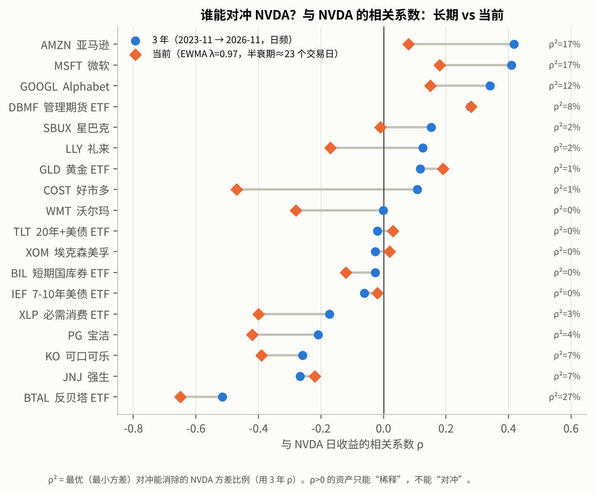
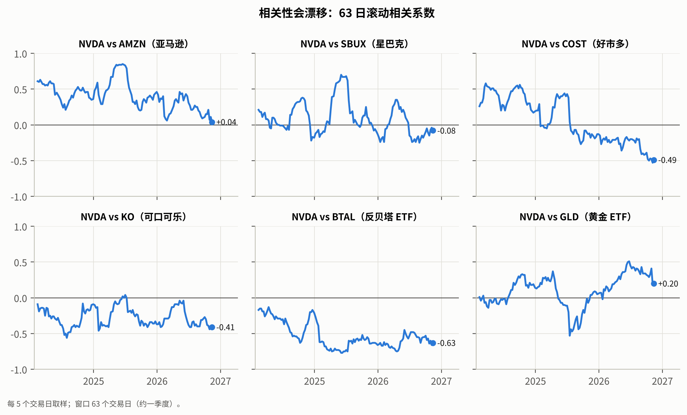
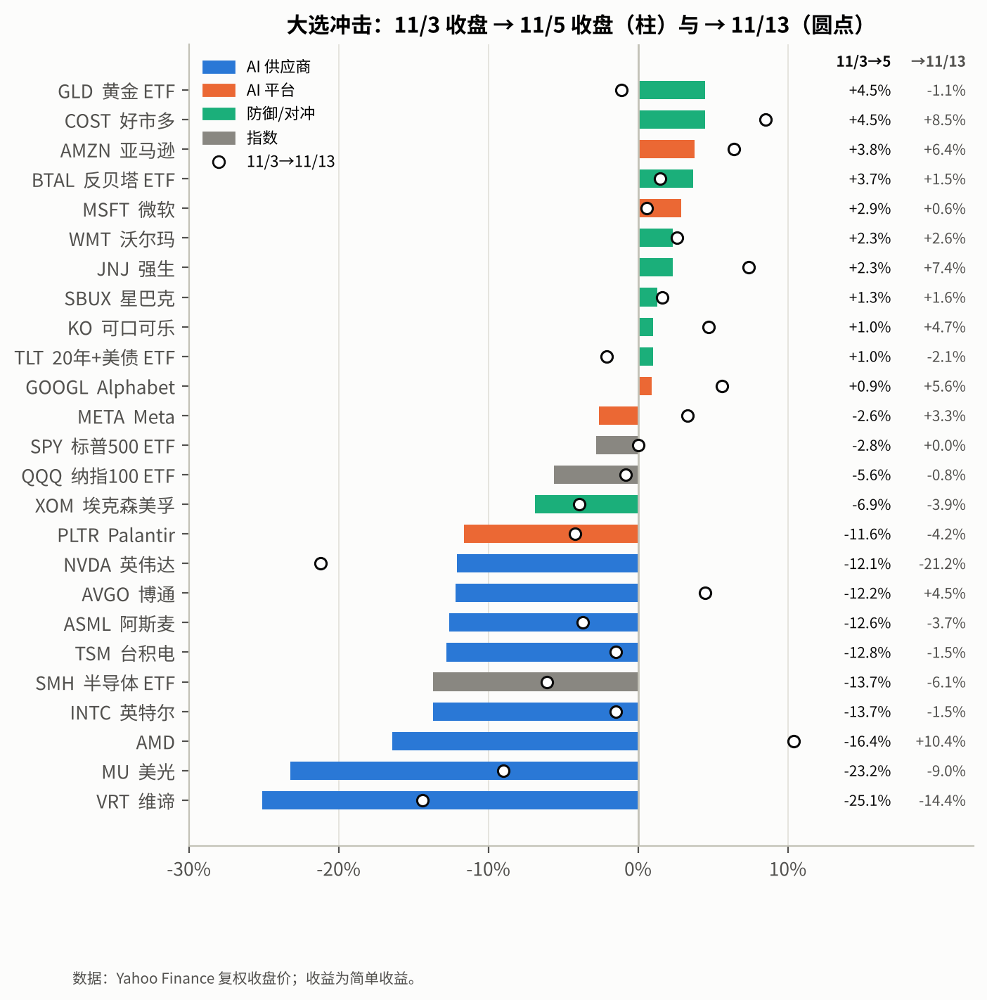
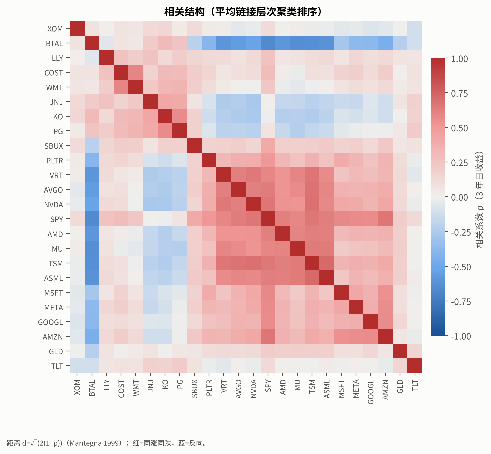
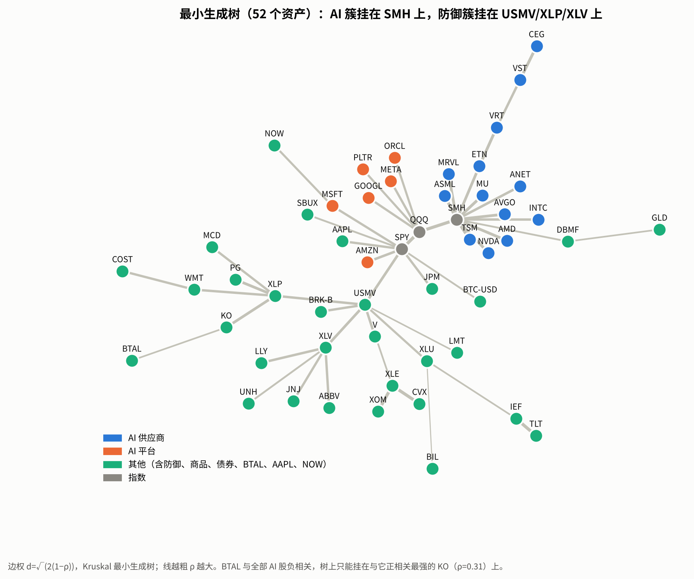
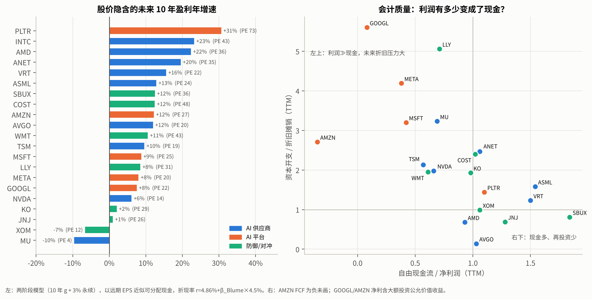
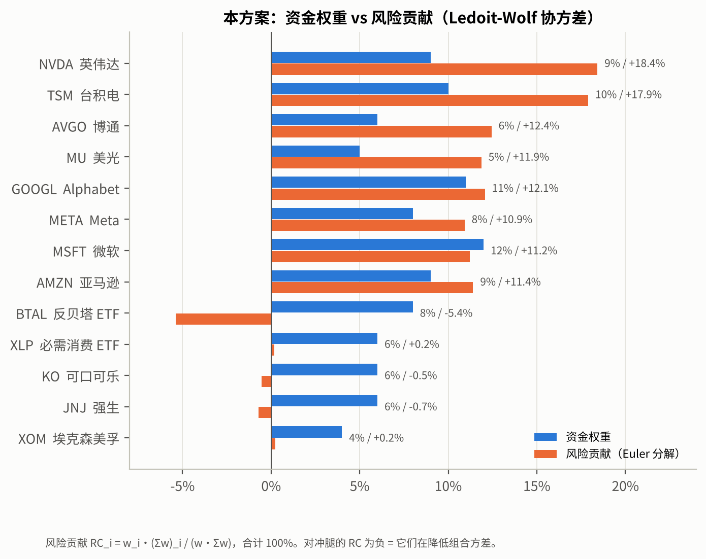
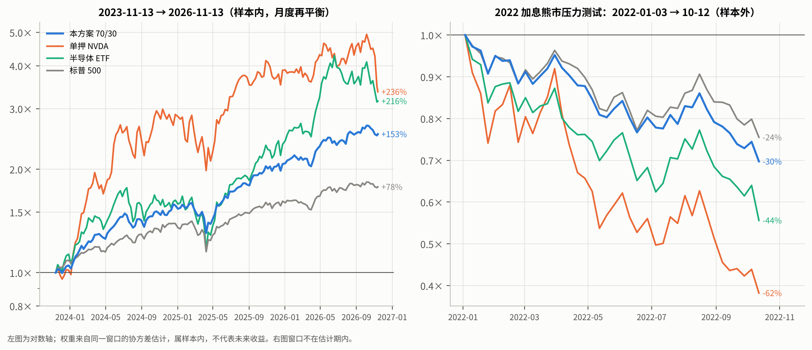
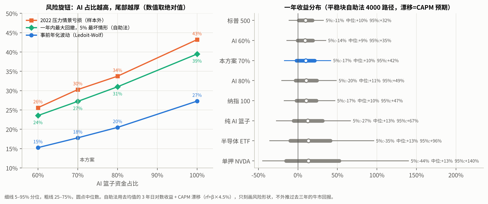

# Claude 独立分析：AI 产业链组合 + 跨行业对冲（截至 2026-11-13 收盘）

> **研究与拟议配置，未执行任何交易，不构成投资建议。** 价格截至 2026-11-13 美股收盘；新闻与基本面截至同日。本目录与仓库内 GPT 版本相互独立，可对照复核（见 §6）。

## 0. 结论

1. **"对冲"和"分散"要分开。** 最小方差对冲比 $h^*=\rho\,\sigma_{NVDA}/\sigma_X$，最优对冲能消除的 NVDA 方差比例只有 $\rho^2$。星巴克 3 年 $\rho=0.15$，$\rho^2=2.3\%$：它只是稀释仓位，不是对冲。亚马逊长期 $\rho=0.42$，是同涨同跌的资产，这次选举中它上涨属于"花钱方 vs 供应商"的事件性分化。
2. **真正与 NVDA 负相关的只有少数：** BTAL（反贝塔 ETF，$\rho=-0.52$，当前 −0.65，$\rho^2=27\%$），以及当前处于负相关状态的必需消费/医药（KO、PG、XLP、JNJ、COST）。长期国债在 2022 年加息通胀期失效（TLT −29%）；黄金当前与 NVDA 正相关。
3. **估值上 NVDA 是 AI 链里最便宜的之一**（远期 PE 13.5，隐含 10 年盈利增速约 6%），但它有 CEO 调查这一特有风险；MU 的 PE 4.4 是周期顶部定价，不是便宜；超大厂的 TTM 利润被 SpaceX/Anthropic 等股权公允价值收益抬高，资本开支是折旧的 3–6 倍。
4. **拟议组合（AI 70% / 对冲 30%）：** 8 只 AI 股（GPU、定制芯片、代工、存储、四家超大厂）+ BTAL/XLP/KO/JNJ/XOM。事前年化波动 17.8%（单押 NVDA 47.1%），β(SPY)=1.00；2022 样本外压力情景 −30.3%（NVDA −61.8%）；大选冲击 11/3→11/5 −3.4%（NVDA −12.1%）。

## 1. 发生了什么

| 日期 | 事件 | 市场 |
|---|---|---|
| 11/3 | 中期选举，民主党拿下参众两院；在德州、佐治亚等数据中心集中地，有候选人以数据中心暂停令为竞选议题 | 11/4 大盘反弹，芯片股承压 |
| 11/5 | 市场开始交易"AI 基建放缓 + 监管/审批风险" | 费城半导体指数 −12%，纳指 −5.5%，标普 −4.4%；NVDA −9.3%，AMD −17% |
| 11/3→11/6 | 分化：AMZN +3.4%、MSFT +1.9%、GOOGL +1.7%，供应商 −7% 至 −19% | 市场押注 capex 放缓利好花钱方的自由现金流 |
| 11/8 起 | NVDA 特有风险：黄仁勋承认婚外情，涉及被指为中国情报人员的人士；董事会独立调查、集体诉讼；众议院共和党委员会主席要求 11/18 闭门简报 | NVDA 11/9 −4.3%，11/10 −5.5% |
| 11/10 | 10 月 CPI 超预期（核心 +0.3%）；12 月加息至 4.00–4.25% 已被完全定价 | 10 年期美债 4.86%（11/6） |
| 11/11 | CoreWeave 财报带动芯片反弹，纳指收复选后跌幅 | — |

**接下来的催化剂：** NVDA 财报 **11/17**（指引营收 $108B ±2%，毛利率 74%；第三方共识 EPS $2.47）· 11/18 国会简报（请求） · FOMC **12/8–9** · 11 月 CPI **12/10**。

## 2. 数据与方法（可复现、可审计）

- **价格**：Yahoo Finance chart API 复权日收盘（含分红、拆股），52 个资产，2021-11-15 至 2026-11-13，共 1,255 个交易日。估计窗口为最近 3 年的 753 个日对数收益（2023-11-14 至 2026-11-13）。原始数据 SHA-256：`50a5432a…cb82b5`。
- **完整性校验**：浏览器端结果转录后逐字节对比 SHA-256，4/4 通过。第二次独立会话重新下载数据并复算本方案的 26 项回测指标，结果完全一致。FMP 独立报价抽查 NVDA、MSFT、KO 的 11/13 收盘价一致。Portfolio Visualizer 的月频相关（2023-11 至 2026-10）与日频结果量级一致：AMZN 0.51 vs 0.42，XLP −0.09 vs −0.17；SBUX −0.03 vs 0.15、GLD −0.08 vs 0.12，两种频率下都接近 0。
- **协方差**：Ledoit-Wolf (2004) 常相关收缩，收缩强度 δ=0.040，平均相关 r̄=0.161。
- **PCA/RMT**：λ₁=13.48（方差占 25.9%），λ₂=7.13（13.7%）；Marchenko-Pastur 上界 λ₊=1.595，超出上界的特征值有 6 个。**PC2 正是"AI 周期 vs 防御"轴**：VRT、MU、MRVL、NVDA、TSM 在一端，XLP、USMV、XLV、KO、PG 在另一端。对冲就是在 PC2 上做反向暴露。
- **结构**：平均链接层次聚类与最小生成树（Mantegna 距离 $d=\sqrt{2(1-\rho)}$）。
- **对冲诊断**：ρ（3 年、1 年、EWMA λ=0.97）、$h^*$、$\rho^2$、下行/上行 β、尾部依赖 $\lambda_L(10\%)=P(X\le q_{10}\mid SMH\le q_{10})$（独立时为 0.10）、2022 窗口与大选窗口收益。
- **估值**：stockanalysis.com 统计页（记录页面价格与日期，倍数按 11/13 收盘价缩放）。折现率 $r=4.86\%+\beta_{Blume}\times4.5\%$，其中 $\beta_{Blume}=0.67\beta+0.33$。两阶段反推：10 年增速 g，之后 3% 永续，以远期 EPS 近似可分配现金，求使模型价值等于股价的 g。会计质量用 FCF/NI、NI/营业利润（>0.9 提示非经营收益）、capex/折旧摊销。
- **组合**：AI 篮子做 ERC（Spinu 凸优化）。估值倾斜规则：0 ≤ 隐含增速 ≤ 10% 且 FCF/NI ≥ 0.5 的名字权重 ×1.5（命中 NVDA、TSM）。对冲腿是给定 AI 篮子时的长仓最小方差对冲，上限为 BTAL 8%、单股 6%、ETF 10%；XOM 设 4% 下限，作为 3 年协方差看不到的通胀/油价情景对冲。最后用风险旋钮选 AI 70%。
- **回测**：月度再平衡。2022-01-03 至 10-12 是样本外窗口。自助法为平稳块自助（平均块长 20 日、4,000 条路径、seed 42），收益先去均值再加 CAPM 漂移，只刻画风险形状，不外推过去三年的牛市。

## 3. 能不能对冲：星巴克、亚马逊与其他候选

| 资产 | ρ（3 年） | ρ（当前 EWMA） | ρ² | 与 NVDA 50/50 波动 | λ_L(10%) | 2022 窗口 | 11/3→11/5 |
|---|---:|---:|---:|---:|---:|---:|---:|
| **SBUX** 星巴克 | 0.15 | −0.01 | 2.3% | 30.6% | 0.18 | −24.2% | +1.3% |
| **AMZN** 亚马逊 | 0.42 | 0.08 | 17.4% | 33.4% | 0.39 | −33.7% | +3.8% |
| COST 好市多 | 0.11 | −0.47 | 1.2% | 26.7% | 0.16 | −17.3% | +4.5% |
| KO 可口可乐 | −0.26 | −0.39 | 6.7% | 23.0% | 0.07 | −4.9% | +1.0% |
| JNJ 强生 | −0.27 | −0.22 | 7.1% | 23.1% | 0.07 | −3.3% | +2.3% |
| XLP 必需消费 | −0.17 | −0.40 | 3.0% | 23.4% | 0.08 | −10.6% | +2.6% |
| XOM 埃克森 | −0.03 | 0.02 | 0.1% | 26.1% | 0.16 | **+59.8%** | −6.9% |
| GLD 黄金 | 0.12 | 0.19 | 1.4% | 27.2% | 0.29 | −7.3% | +4.5% |
| TLT 长债 | −0.02 | 0.03 | 0.0% | 24.3% | 0.11 | **−29.3%** | +1.0% |
| **BTAL** 反贝塔 | **−0.52** | **−0.65** | **26.6%** | **20.6%** | 0.01 | +16.6% | +3.7% |

NVDA 单独波动 47.1%。几点解读：

- **SBUX 不是对冲**：50/50 组合降波动主要靠稀释，组合与 NVDA 的相关仍有 0.85。2022 年 NVDA+SBUX 各半亏 −44.5%，选举日以来亏 −9.9%（§5 表）。SBUX 自身远期 PE 36，净债务 $18.8B，峰度 26（财报跳空多）。
- **AMZN 是"经济对冲"，不是统计对冲**：数据中心建设放缓时，供应商少收钱、花钱方少花钱，所以这次两者背离。但长期 ρ=0.42，2022 年照样跌 34%。
- **BTAL 是唯一稳定的负相关资产**，代价是负 carry：3 年年化 −10.6%（AI 牛市里一直在付保费），所以上限设为 8%。
- **相关性会漂移**：COST 从 2024 年的 +0.5 变成当前的 −0.49。滚动图见下。
- **不对称 β**：AI 电力/基础设施在下跌时放大。VRT 下行 β 1.42、上行 0.94；ANET 1.12 vs 0.65；VST 1.16 vs 0.73。这是不把 VRT 放进核心的原因之一。

## 4. AI 产业链扩展与估值（会计视角）

| 代码 | 远期 PE（11/13） | FCF 收益率 | 隐含 10 年盈利增速 | FCF/净利 | 净利/营业利润 | capex/折旧 | 判断 |
|---|---:|---:|---:|---:|---:|---:|---|
| NVDA | 13.5 | 3.2% | 6.1% | 0.66 | 0.98 | 2.0 | 最便宜之一。净利含股权投资收益（Q1 $15.9B、Q2 $7.8B），Q2 应收账款增加 $22.3B，现金转化偏低 |
| TSM | 19.1 | 2.4% | 9.6% | 0.57 | 0.88 | 2.1 | 净现金 $100B，ROIC 60%，中性偏便宜 |
| AVGO | 19.9 | 2.4% | 12.0% | 1.03 | 0.88 | 0.1 | 现金转化好，净负债 $35B |
| MU | 4.4 | 6.7% | **−9.6%** | 0.69 | 0.86 | 3.2 | **周期顶部定价**：营业利润率 75%，市场隐含盈利每年回落约 10% |
| GOOGL | 21.5 | 0.5% | 7.5% | **0.08** | **1.50** | **5.6** | 2026 前 9 个月股权证券净收益 $127.3B，超过营业利润 $121.0B；TTM PE 15 被扭曲 |
| META | 19.5 | 1.7% | 8.0% | 0.38 | 0.82 | 4.2 | capex $104B，FCF 被压缩 |
| MSFT | 25.2 | 1.5% | 8.7% | 0.42 | 0.87 | 3.2 | capex $136B |
| AMZN | 27.0 | **−1.6%** | 12.2% | 负 | **1.29** | 2.7 | FCF −$46.9B，净债务 $191B，净利含投资收益 |
| AMD | 35.5 | 0.8% | 22.3% | 0.93 | 0.94 | 0.7 | 年内 +149%，估值已包含大量增长 |
| PLTR | 73.1 | 1.0% | 30.6% | 1.10 | 1.10 | 1.4 | 89% 的股价是增长溢价 |
| INTC | 42.9 | 1.2% | 23.2% | — | 亏损 | 1.1 | TTM 净亏 $12.0B，距 52 周高点 −58% |
| VRT | 21.8 | 4.0% | 15.5% | 1.50 | 0.76 | 1.2 | 基本面好，但下行 β 不对称，且直接暴露于数据中心审批风险 |
| COST | 48.5 | 1.9% | 12.4% | 1.02 | 0.80 | 2.4 | "防御股"但 PE 48；2022 年 −17% |
| KO / JNJ / XOM | 28.6 / 25.7 / 12.0 | 3.3% / 3.0% / 6.2% | 2.0% / 1.0% / −6.7% | 0.98 / 1.28 / 1.06 | — | — | 估值包含的增长预期低，适合做对冲腿 |

**会计要点**

- **非经营收益扭曲 PE**：Alphabet 2026 年 Q2 确认 $99.0B 股权证券收益（SpaceX 6 月 IPO、Anthropic 估值上调），Q3 又因 SpaceX 下跌亏 $8.7B。远期 PE（21）高于 TTM PE（15）就是这个信号。AMZN 的净利/营业利润 = 1.29，同理。
- **折旧"剪刀差"**：GOOGL 的 capex/折旧 = 5.6×，META 4.2×，MSFT 3.2×。现有服务器折旧年限 5.5–6 年，GPU 的经济寿命可能只有 3–4 年。JPMorgan AM 测算：把 2023 年以来的 GPU/网络 capex 按 3 年寿命重述，2025 年 EPS 会下降 6–17%（ORCL 最多）。资本开支持续高位时，超大厂未来的利润率有下行压力。
- **NVDA 的现金流质量**：Q2 FY27 GAAP 净利 $59.7B 中含 $7.8B 股权收益；经营现金流环比减半，主要因为应收账款增加 $22.3B；同季借入 $25B，回购加分红 $26B。不影响"便宜"的结论，但财报日要看应收账款和供应商融资是否继续膨胀。

**AI 扩展的取舍**：核心纳入 NVDA、TSM、AVGO、MU、GOOGL、META、MSFT、AMZN，覆盖 GPU、定制芯片/网络、代工、HBM 存储和四家超大厂，供应商与花钱方互为内部对冲。AMD、PLTR、INTC、ANET 因隐含增速过高不纳入；VRT 因下行 β 不对称和审批风险不纳入；ASML 与 TSM 的 ρ=0.71，功能重复，不纳入。它们可以作为卫星仓位的观察名单。

## 5. 拟议组合（$7,000，可按同权重扩到 $10,000）

| 代码 | 角色 | 权重 | $7,000 | $10,000 | 11/13 收盘 | 约合股数（$7k，需支持碎股） | 风险贡献 |
|---|---|---:|---:|---:|---:|---:|---:|
| NVDA | AI 供应商 · GPU | 9% | $630 | $900 | 162.85 | 3.87 | 18.4% |
| TSM | AI 供应商 · 代工 | 10% | $700 | $1,000 | 398.73 | 1.76 | 17.9% |
| AVGO | AI 供应商 · ASIC/网络 | 6% | $420 | $600 | 347.01 | 1.21 | 12.4% |
| MU | AI 供应商 · HBM（周期） | 5% | $350 | $500 | 778.31 | 0.45 | 11.9% |
| GOOGL | AI 平台 · TPU/Gemini/云 | 11% | $770 | $1,100 | 295.77 | 2.60 | 12.1% |
| META | AI 平台 | 8% | $560 | $800 | 641.69 | 0.87 | 10.9% |
| MSFT | AI 平台 · Azure | 12% | $840 | $1,200 | 523.88 | 1.60 | 11.2% |
| AMZN | AI 平台 · AWS | 9% | $630 | $900 | 266.66 | 2.36 | 11.4% |
| BTAL | 对冲 · 反贝塔 | 8% | $560 | $800 | 13.33 | 42.0 | −5.4% |
| XLP | 对冲 · 必需消费 | 6% | $420 | $600 | 92.35 | 4.55 | 0.2% |
| KO | 对冲 · 必需消费 | 6% | $420 | $600 | 99.25 | 4.23 | −0.5% |
| JNJ | 对冲 · 医药 | 6% | $420 | $600 | 285.75 | 1.47 | −0.7% |
| XOM | 对冲 · 通胀/油价情景 | 4% | $280 | $400 | 170.59 | 1.64 | 0.2% |
| **合计** | AI 70% / 对冲 30% | 100% | $7,000 | $10,000 | | | 100% |

**风险与回测对照**（3 年为样本内，2022 为样本外；自助法分位数基于 CAPM 漂移）

| 组合 | 事前/实现波动 | 当前波动（EWMA） | 3 年最大回撤 | 2022 压力 | 11/3→11/5 | 11/3→11/13 | 1 年 5% 分位 | 1 年中位数 | P(1 年亏 >20%) |
|---|---:|---:|---:|---:|---:|---:|---:|---:|---:|
| **本方案 70/30** | 17.8% / 17.9% | 18.2% | −19.1% | **−30.3%** | **−3.4%** | **+0.2%** | −17.1% | +9.9% | 3.0% |
| 单押 NVDA | 47.1% / 47.2% | 47.2% | −36.9% | −61.8% | −12.1% | −21.2% | −44.5% | +13.3% | 20.7% |
| 半导体 ETF SMH | — / 38.4% | 53.4% | −35.7% | −44.4% | −13.7% | −6.1% | −35.5% | +13.4% | 15.5% |
| 纳指 100 QQQ | — / 21.0% | 28.1% | −22.8% | −34.3% | −5.6% | −0.8% | −17.3% | +10.5% | 3.4% |
| 标普 500 SPY | — / 15.5% | 17.2% | −18.8% | −24.5% | −2.8% | 0.0% | −11.1% | +9.8% | 0.8% |
| NVDA+SBUX 各半 | — / 30.9% | 26.5% | −30.4% | −44.5% | −5.5% | −9.9% | −28.8% | +11.6% | 10.7% |
| NVDA+AMZN 各半 | — / 33.8% | 30.1% | −31.1% | −49.2% | −4.2% | −7.4% | −32.4% | +12.3% | 13.3% |
| NVDA 70 + BTAL 30 | — / 30.4% | 27.6% | −23.9% | −43.5% | −7.5% | −14.6% | −32.6% | +9.6% | 13.8% |

**风险旋钮**（对冲腿随 AI 占比重新优化）

| AI 占比 | 事前波动 | β(SPY) | 2022 压力 | 10/6→11/13 | 1 年 5% 分位 | 一年内 5% 最坏回撤 |
|---|---:|---:|---:|---:|---:|---:|
| 60% | 15.3% | 0.87 | −25.6% | −3.4% | −13.9% | −23.6% |
| **70%（本方案）** | **17.8%** | **1.00** | **−30.3%** | **−5.5%** | **−17.1%** | **−27.2%** |
| 80% | 20.5% | 1.13 | −33.7% | −8.1% | −20.4% | −31.0% |
| 100% | 27.3% | 1.49 | −43.2% | −12.6% | −27.2% | −39.5% |

## 6. 与仓库中 GPT 版本（`conviction8`）的对照

同一协方差、同一价格数据，VTI 用 SPY 代理，SGOV 用 BIL 代理；窗口收益按买入持有计算。

| 指标 | Claude 70/30 | GPT conviction8 |
|---|---:|---:|
| 直接 AI 股权重 | 70% | 45% |
| 事前年化波动（LW） | 17.8% | 17.4% |
| β(SPY) / β(SMH) | 1.00 / 0.38 | 1.03 / 0.34 |
| 与 NVDA 相关 | 0.77 | 0.80 |
| 2022 窗口（买入持有） | −27.6% | −30.8% |
| 11/3→11/5 | −3.3% | −2.2% |
| 11/3→11/13 | +0.2% | −1.3% |
| 10/6→11/13 | −5.3% | −6.5% |
| CAPM 预期收益 | 9.35% | 9.49% |

两者总风险接近。本方案的直接 AI 敞口多 25 个百分点，但在 2022 情景和选后一周更抗跌，代价是选举当周两天跌得更多（−3.3% vs −2.2%）。差异来源：GPT 版用 35% VTI 承担市场 β；本方案用 BTAL + 必需消费 + XOM 承担"PC2 反向"暴露。两版都没有被证明为全局最优。

## 7. 执行与风控

- **分批进场**：本周有两个二元事件（11/17 NVDA 财报、11/18 国会简报），之后是 12/9 FOMC。分批不提高期望收益，只降低入场价的方差，例如一半现在、一半在 12/10 之后。
- **再平衡**：每季度一次，或任一仓位偏离目标超过 ±3 个百分点时。理论分散化收益 $\tfrac12(\sum w_i\sigma_i^2-\sigma_p^2)\approx4.6\%$/年（对数，上限，不保证）。
- **不建议**：
  - 杠杆或反向 ETF。−3× 日再平衡 ETF 的期望对数收益约为 $-\tfrac{L^2}{2}\sigma^2$。若半导体指数一年持平、波动 38%，SOXS 约 −66%（对数），即净值约 −48%。
  - 期权对冲。$7k 规模下不可行：1 张 SMH 看跌期权对应约 $48.7k 名义金额。
- **人力资本**：你的职业方向（AI/ML 研究）本身就是 AI 的长头寸。按 Merton/Bodie 的人力资本观点，金融资产里保留一条与 AI 负相关的腿是理性的。
- **监控信号**：NVDA CEO 调查与诉讼；新国会的数据中心审批立法；超大厂 capex 指引；12 月加息幅度；油价与伊朗局势；MU 回购限制在 12 月解除后的资本配置。

## 8. 局限

- 3 年窗口覆盖 AI 牛市，样本内回测偏乐观；2022 才是样本外。
- 相关性随市场状态漂移（见 §3 滚动图）。
- 估值依赖页面日期的远期 EPS 共识与 ERP 假设（4.5%）；反推增速对 r 敏感。
- 未计税费、价差与汇率。

## 9. 文件

| 路径 | 内容 |
|---|---|
| `data/` | `stats_daily.csv`（52 资产日频统计）、`matrix_block.txt`（相关矩阵、波动、滚动相关）、`backtest.json`、`backtest_ai60.json`、`meta.json`（来源、SHA-256、假设） |
| `js/` | 在 Yahoo 同源页面执行的浏览器 JS：取数、统计、协方差/LW、回测/自助法 |
| `analysis.py` 等 | `analysis.py`（门控校验、协方差、PCA/RMT、聚类/MST、对冲诊断、估值、ERC/对冲腿/风险旋钮/HRP）、`build_datasets.py`、`make_figures.py` |
| `out_*` | `out_valuation.csv`、`out_hedges.csv`、`out_portfolios.json`、`out_final.json`、`out_FINAL.json`、`out_compare_gpt.json`、`out_log.txt` |
| `ds/` | 机器可读数据集（JSON `{rows, meta}`，meta 内含生成代码全文与输入哈希），供其他 agent 直接读取 |
| `figures/` | f1–f9 图表 |
| `manifest.json` | 本目录所有文件的 SHA-256 |

复算（在本目录内）：`python3 analysis.py && python3 build_datasets.py && python3 make_figures.py`，依赖 numpy、pandas、scipy、networkx、matplotlib 和 Noto Sans CJK 字体。浏览器步骤（`js/`）需要在 `query1.finance.yahoo.com` 同源页面的控制台执行；它的输出已冻结在 `data/` 中，并有 SHA-256 记录。

## 来源

- 选举与芯片抛售：[The Edge (Reuters)](https://theedgemalaysia.com/node/824761) · [EM360Tech](https://em360tech.com/index%2Ephp/tech-articles/us-election-results-ai-data-centre-stocks-sell-off) · [Trefis](https://www.trefis.com/stock/nvda/articles/623357/what-sent-nvidia-stock-lower/2026-11-06) · [Finimize](https://finimize.com/content/markets-back-a-democratic-congress-while-ai-chips-slip) · [Money365（花钱方 vs 供应商）](https://www.money365.market/articles/ai-stocks-after-midterms-chips-vs-big-tech) · [Motley Fool（Intel）](https://fool.com/investing/2026/11/05/why-intel-stock-is-down-today) · [Crypto Briefing（11/11 反弹）](https://cryptobriefing.com/nasdaq-erases-post-election-losses-ai-rally/)
- NVDA 特有风险：[Al Jazeera](https://www.aljazeera.com/economy/2026/11/9/nvidia-shares-slump-amid-investigation-into-ceo-jensen-huang) · [Finviz](https://finviz.com/news/418813/nvidia-shares-fall-more-than-4-as-board-investigates-allegations-involving-ceo-jensen-huang) · [Crypto Briefing（NYT 后续报道）](https://cryptobriefing.com/nvidia-ceo-scandal-market-impact/) · [Stocktwits（集体诉讼）](https://stocktwits.com/news-articles/markets/equity/nvidia-faces-class-action-suit-over-huang-allegations-senator-seeks-probe-analyst-puts-ceo-exit-odds-at-15/cNGuT97R97g)
- NVDA 财报与日程：[NVIDIA IR：11/17 电话会](https://investor.nvidia.com/news/press-release-details/2026/NVIDIA-Sets-Conference-Call-for-Third-Quarter-Financial-Results/) · [NVIDIA IR：Q2 FY27](https://investor.nvidia.com/news/press-release-details/2026/NVIDIA-Announces-Financial-Results-for-Second-Quarter-Fiscal-2027/) · [Beancount（现金流拆解）](https://beancount.io/blog/2026/08/26/nvidia-fy2027-q2-earnings-analysis) · [ECIKS（共识）](https://eciks.org/29651-nvidia-fiscal-2027-q3-results)
- 会计：[FourWeekMBA（Alphabet 股权收益）](https://fourweekmba.com/ai-googles-8-7b-stake-loss-follows-136b-gain-in-two-quarters/) · [Unite.AI（Alphabet Q3）](https://www.unite.ai/?p=496723) · [Fortune（循环融资）](https://www.fortune.com/2026/07/22/anthropic-spacex-investments-google-earnings-biggest-ever-profit-quarter/) · [DataGravity（折旧敏感性）](https://www.datagravity.dev/p/how-long-does-a-gpu-last) · [Dave Friedman（$176B）](https://davefriedman.substack.com/p/the-176-billion-accounting-question)
- 宏观：[Political.org（10 月 CPI 与加息概率）](https://political.org/2026/11/10/fed-officials-open-door-to-half-point-rate-hike-in-december-after-october-inflation-report-tops-forecasts/) · [StockWireX](https://stockwirex.com/?p=55671) · [YCharts（10 年期）](https://ycharts.com/indicators/10_year_treasury_rate)
- 数据：Yahoo Finance chart API（复权收盘）· [stockanalysis.com 统计页](https://stockanalysis.com/stocks/nvda/statistics/) · [Portfolio Visualizer（月频相关交叉验证）](https://www.portfoliovisualizer.com/asset-correlations) · Financial Modeling Prep（报价抽查）
