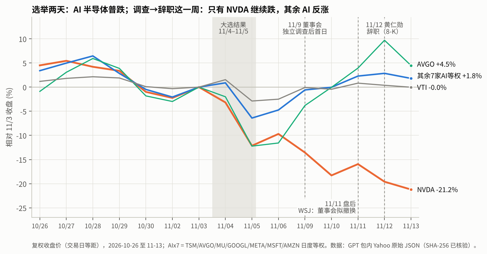

# Claude 分析 2026-11-14：NVDA 的江湖地位 + 「AI 广度 × 适度 NVDA」无杠杆组合

- 价格截至 2026-11-13 收盘，新闻截至 2026-11-14。
- 本文是分析，不是交易指令。我不是持牌投资顾问，也没有执行任何交易。
- 所有收益数字都是历史数据或明确标注的情景，不含预期收益预测。

---

## 0. 先说判断

**1. NVDA 的江湖地位：技术、供给、需求三层仍是第一；"相对地位"和治理层在变弱，而且市场已经在价格里投票。**

- **仍然稳的部分**
  - Vera Rubin 已量产出货。
  - Q3 FY27 营收指引 $108B ±2%。
  - 管理层称供给紧张至少持续到 FY28 末。
  - 多家机构估计 2026 年加速器收入份额在 70–86%。
- **变弱的部分**
  - 创始人 CEO 于 11/12 辞职：CFO 兼任临时 CEO，董事会首设董事长，并在内外部搜寻继任者。
  - 丑闻推动出口管制收紧的立法和行政动作。
  - 定制 ASIC 在推理侧持续蚕食份额：Broadcom FY26 AI 收入指引 $58B；AMD Helios 已开始出货。
  - 内存成本压毛利：管理层预计 Q4 毛利率低点为 71–72%。
- **市场投票（本轮数据，§3）**
  - 11/9–11/13 这五个交易日，NVDA 的累计异常收益为 **−20.9%（t = −4.6）**。
  - 同期其余 7 家 AI 等权 **+6.9%**，AVGO 异常收益 **+11.2%（t = +2.1）**。
  - 结论：这是 NVDA 特有的冲击，不是 AI 需求冲击。
  - 这个趋势早于丑闻：
    - 126 日滚动窗口里，NVDA 特有风险占比从 2025 年中约 20% 升到 **63%**。
    - NVDA 对其余 AI 的 beta 从约 1.3 降到 **0.30**。
    - 2026 年至今 NVDA **−12.5%**，其余 7 家等权 **+31.5%**。
- **估值：价格里已有不少悲观**
  - 远期 P/E 为 13.5x。
  - 修正首年时点后，EPS 口径隐含 10 年增长 7.1%；TTM FCF 口径为 18.0%，对口径敏感。
  - 零增长价值约占股价 60%。
- **盈利质量有警示**
  - FCF/NI 0.66。
  - NI/OpInc 0.98，说明净利中有较多非经营收益。
  - 公司曾宣布融资计划，可能提供最高 $125B 的担保。

**你的立场——"保留对其行业地位的信心，但降低乐观"——与证据一致。** 落到仓位上：NVDA 仍应是组合里最大的单一 AI 发行人，但不应再主导组合风险。

**2. 组合：在 GPT conviction8 同样的历史波动下，把 NVDA 集中风险换成 AI 广度。**

| 指标 | GPT conviction8 | **Hybrid-核心** |
|---|---:|---:|
| 3 年实现波动（季度再平衡） | 17.68% | **17.61%** |
| NVDA 穿透敞口（含 VTI） | 16.8% | **11.3%** |
| NVDA 发行人风险贡献（含 VTI） | 36.1% | **24.3%** |
| AI 8 家穿透总敞口 | 53.3% | **52.9%** |
| 敞口 ≥3% 的 AI 发行人数 | 4 | **8** |
| 有效独立下注数 ENB（发行人层） | 4.6 | **8.0** |
| 情景：NVDA 再跌 30%（仅 NVDA） | −5.0% | **−3.4%** |
| 2022 压力回放（季度再平衡） | −32.5% | **−30.4%** |
| 11/6→11/13 调查→辞职周 | +0.2% | **+1.9%** |

- 两者的 3 年波动差为 −0.07pp，配对区块 bootstrap 的 95% 区间为 [−0.42, +0.36]pp，即统计上是同风险。
- Hybrid 无杠杆，不含 BTAL 或其他做空工具。
- **代价**：选举两天跌得更多（−2.9% vs −2.2%）。原因是 Hybrid 持有 TSM/AVGO/MU，这三只在选举中跌了 12–23%。
- **同风险是向后看的**：在"只用前两年标定、最后一年检验"的 holdout 里，Hybrid 最后一年的波动比 conviction8 高 1.4pp（§4.5）。

**3. 与 GPT 的关系**

- 我接受 GPT 的全部方法性批评（§5）。
- 分歧只有一处：GPT 的"本轮不改权重"写于 11/13，正文没有纳入 11/12 的 CEO 交接，也早于你"降低 NVDA 乐观"的新表述。
- 在这两个新信息下，conviction8 的 NVDA 风险占比 36% 已不匹配你的偏好；GPT 初始版的 NVDA 仓位合适，但 AI 广度只有 4 家发行人。
- Hybrid 采用 GPT 的骨架（VTI 宽基、BRK-B/XLV/SGOV 防御、季度再平衡、穿透口径），加上我的 AI 广度袖。

---

## 1. 本轮做了什么

1. **GPT 审查包入库**：原样放入 [`../gpt_review_20261113/`](../gpt_review_20261113/)，详见该目录的 `README_IMPORT.md`。
   - zip 的 SHA-256 为 `5f74e0f0…bf47`，共 69 个文件；其 MANIFEST 68/68 哈希一致。
   - 对话版评审另存为 `GPT_chat_review_20261113.md`。
2. **独立复核**：自写代码 `analysis_20261114.py`，没有运行 GPT 的 .py 文件，只读取其原始数据。
3. **NVDA 地位研究**：新闻与一手文件（SEC 8-K），加上价格诊断（事件研究、因子脱钩、份额转移偏相关）。
4. **组合构造**：无杠杆的 Hybrid 家族，按"同历史风险"对标三个现有方案，统一使用 GPT 的季度再平衡口径。
5. **勘误**：对 `claude_analysis_20261113` 的更正见 §5，以及 [`../claude_analysis_20261113/ERRATA_20261114.md`](../claude_analysis_20261113/ERRATA_20261114.md)。

## 2. 证据链与复核结果

| 检查 | 结果 |
|---|---|
| GPT 20 个 Yahoo 原始 JSON 的 SHA-256 vs GPT MANIFEST | 20/20 一致 |
| 原始 JSON → 价格表 vs GPT 的 `adjusted_close.csv` | 1,255 个交易日（2021-11-15→2026-11-13）× 20 资产，最大相对差 4.4e-16 |
| GPT 价格 vs 我 11/13 浏览器冻结统计（18 个重叠资产）：3 年波动、2022 收益、11/3→11/5、11/3→11/13、10/6→11/13、与 NVDA 的相关 | 6 项指标 × 18 资产全部在显示精度内 |
| 我的冻结 52 资产相关矩阵（3 位小数）在 18 资产子集上 | 153 对中 152 对在舍入误差内，最大差 0.00056 |
| 冻结矩阵的 VOL 行 | 使用 1/T 口径（ddof=0），与重算差 4.5e-6；`stats_daily.csv` 用 1/(T−1)。两者口径不同但都可复现，已记录 |
| 我的分段算法 vs GPT 的逐日持仓循环（季度、月度、买入持有三种规则） | 17 个组合的 3 年净值路径最大差 6.2e-15；561 行指标最大差 8.5e-15 |

**结论**
- GPT 的数字可以独立复现。
- 我 11/13 那一轮的冻结统计与 GPT 重新取得的原始价格一致。
- 这部分补上了 GPT 指出的"52 资产原始价格文件缺失"这一缺口：在 18 个重叠资产上已验证；其余 34 个资产仍未验证。

---

## 3. NVDA 的江湖地位：分层证据

### 3.1 基本面与事件（来源见 §8）

| 层面 | 证据 | 判断 |
|---|---|---|
| 产品路线 | Vera Rubin 已全面量产，2026 下半年向云厂商出货；8-K 称运营、客户承诺和路线图将"不间断"延续 | **稳**（未来 2–4 个季度） |
| 需求与规模 | Q3 指引 $108B ±2%，一致预期约 $108.8–109B；Morningstar 估 FY27 数据中心收入约 $385B（FY26 为 $194B）；管理层称供给瓶颈至少持续到 FY28 末 | **稳** |
| 份额 | 2026 年加速器收入份额的机构估计在 70–86% 之间（2024 年峰值约 87%）；ASIC 服务器约占 2026 年加速器服务器出货的 27.8%；Broadcom FY26 AI 收入指引 $58B（+186%），已有 6 家 XPU 客户；AMD Helios 已出货 | **缓慢下降**，属结构性变化，早于丑闻 |
| 利润率 | Q3 毛利率指引约 74%（下限 73.5%）；内存涨价使 Q4 低点降到 71–72%；FY28 计划提价，目标回到 72–73% | **承压** |
| 中国与政策 | 两党议员借丑闻推动 AI Overwatch Act、Chip Security Act；据报道 Commerce 起草几乎所有 AI 加速器出口都需审批的规则；众议院三委员会要求 11/18 闭门简报；Megaspeed 关联方在被查期间购买了 ≥$4.8B 的 NVIDIA 设备 | **变弱**，新增风险源 |
| 领导力与治理 | 黄仁勋 11/12 辞去 CEO 和董事；Kress 以 CFO 兼任临时 CEO；Harvey Jones 成为首任董事长；董事会从内外部搜寻继任者 | **明显变弱**（短期）；关键人风险已兑现 |

### 3.2 市场怎么定价（本轮数据，`out/` 与 `figures/`）



**事件研究**（[f2](figures/f2_event_study_car.png)，`out/event_study_ai8.csv`）
- 模型：R_i = a + b1·R_VTI + b2·AI 因子 + e。NVDA 的 AI 因子为其余 7 家等权；其余公司各自使用剔除自身和 NVDA 后的 6 家等权。
- 估计窗：2023-11-14 → 2026-10-30，不含事件日。

| CAR | NVDA | TSM | AVGO | MU | GOOGL | META | MSFT | AMZN |
|---|---:|---:|---:|---:|---:|---:|---:|---:|
| 选举 11/4–11/5 | −5.2% | **−7.6%** (t −3.1) | −5.8% | **−18.5%** (t −3.9) | +4.4% | +1.7% | **+6.0%** (t +3.1) | **+8.7%** (t +4.1) |
| 调查→辞职 11/9–11/13 | **−20.9%** (t −4.6) | −0.7% | **+11.2%** (t +2.1) | +4.5% | +0.5% | +1.3% | −3.8% | −1.2% |

- **选举冲击是"半导体 vs 平台"的轮动。**
- **CEO 事件只打在 NVDA 身上**：NVDA 原始收益 −12.75%，而其 AI 因子 +6.87%。
- 唯一显著的正向反应是 AVGO（定制 ASIC 的设计方），与"份额转移"叙事一致。
- 11/12–11/13（辞职公布后两日）NVDA CAR −5.5%（t −1.9），属边际显著。

**脱钩是一个趋势，不只是一周的事**（[f3](figures/f3_nvda_decoupling.png)）

| 年份 | NVDA | 其余 7 家等权 | SMH |
|---|---:|---:|---:|
| 2024 | +171% | +53% | +39% |
| 2025 | +39% | +57% | +49% |
| 2026 至今 | **−12.5%** | **+31.5%** | **+35.2%** |

- 3 年全样本：beta_AI 0.89，R² 0.51。
- 126 日滚动：2025 年中 beta 约 1.3、R² 约 0.8；到 11/13 beta 降到 0.30，特有风险占比升到 0.63（样本内最高值 0.64 出现在 2026-09-30，早于丑闻）。
- 2026 年 NVDA 的价格越来越由自身因素决定：毛利率、中国、份额、治理。
- 2026 年高点为 10/6 的 $239.24，11/13 收 $162.85，回撤 −31.9%。

**谁在对冲 NVDA 的特有风险？**（[f7](figures/f7_share_shift.png)，`out/share_shift_partial_corr.csv`）
- 方法：事件前 743 天，两两对 VTI 和剔除二者后的 AI 等权因子回归，取残差。

| | TSM | AVGO | MU | META | MSFT | AMZN | GOOGL |
|---|---:|---:|---:|---:|---:|---:|---:|
| 与 NVDA 残差的偏相关 | +0.36 | +0.28 | +0.18 | +0.06 | +0.08 | −0.06 | −0.06 |
| NVDA 最差 10% 特有日的平均特有收益 | −114bp | −68bp | −67bp | −27bp | −37bp | +4bp | **+21bp** |

- 平常日子里，**TSM/AVGO/MU 不对冲 NVDA 的特有风险，反而跟着它跌**（供应链和半导体子因子）。
- 只有 GOOGL（TPU）略有对冲作用，AMZN（Trainium）接近中性。
- 本次 CEO 事件是例外：AVGO 走出 +11% 的特有行情。
- 对组合的含义：分散持有 AI 名字主要是在**分摊** NVDA 的特有风险，不是在**对冲**它。唯一真正降低 NVDA 特有风险的杠杆，是 NVDA 自己的权重。

### 3.3 估值与会计质量（`out/valuation_timing_corrected.csv`）

| | NVDA | AVGO | TSM | MU | GOOGL | MSFT |
|---|---:|---:|---:|---:|---:|---:|
| 远期 P/E（按 11/13 收盘重标） | **13.5** | 19.9 | 19.1 | 4.4 | 21.5 | 25.2 |
| 隐含 10 年增长：EPS 口径，**首年时点已修正** | **7.1%** | 13.8% | 11.1% | −11.9% | 8.6% | 10.0% |
| 隐含 10 年增长：TTM FCF 口径 | 18.0% | 23.0% | 19.6% | 8.7% | 36.7% | 21.6% |
| 零增长价值 / 股价（Penman，r = CAPM） | **60%** | 40% | 45% | 164% | 48% | 43% |
| FCF / NI | **0.66** | 1.03 | 0.57 | 0.69 | 0.08 | 0.42 |
| NI / OpInc（>0.9 提示非经营收益） | **0.98** | 0.88 | 0.88 | 0.86 | 1.50 | 0.87 |

- **读法**：股价已经假设 NVDA 在明年之后大幅降速（EPS 口径约 7%/年）。
- 但现金转化偏弱，部分利润来自非经营收益，再加上可能高达 $125B 的融资担保计划，这些都是"降低乐观"的会计理由。
- **同一张表的另一面**：GOOGL、MSFT 的 FCF/NI 更低（0.08、0.42），因为它们的资本开支正是 NVDA 的收入来源。云厂商自由现金流能否继续支撑资本开支，是整个 AI 链共同的风险，不只是 NVDA 的。
- **局限**：远期 EPS 是 FY1 还是 NTM、GAAP 口径与股数基础，原材料都没有逐项冻结（GPT 的批评成立）。所以这张表只用于定性判断，不再驱动权重。

---

## 4. 组合：Hybrid（AI 广度 × 适度 NVDA，无杠杆）

### 4.1 构造规则（全部写在 `analysis_20261114.py` 第 5 节）

1. **VTI 25%**：保留 GPT 的宽基思路，从 35% 让出 10pp 给 AI 广度。
2. **NVDA 直接持有 10%**：与 GPT 初始版相同；含 VTI 穿透后为 11.3%，仍是组合里最大的单一 AI 发行人。
3. **其余 7 家 AI 按等风险贡献（ERC）分配**（3 年简单收益协方差，Spinu 凸优化）。袖内比例：

   | MSFT | GOOGL | AMZN | META | TSM | AVGO | MU |
   |---:|---:|---:|---:|---:|---:|---:|
   | 21.4% | 18.1% | 15.4% | 14.4% | 12.1% | 10.0% | 8.6% |

4. **防御袖** 按 GPT 初始版的比例分配：BRK-B 40 / XLV 20 / SGOV 40。
5. **AI 篮子总规模 A** 用 brentq 求解，使 3 年季度再平衡的实现波动等于所对标方案的波动：
   - 稳 = GPT 初始版 15.81%（A = 38.7%）
   - 核心 = GPT conviction8 17.68%（A = 47.1%）
   - 进取 = Claude 11/13 版 18.30%（A = 49.7%）
6. **取整**：权重取整到 1%。袖内用最大余数法，保持各袖总量不变；AI 袖总量在 floor/ceil 两个候选中，取波动更贴近目标的一个。

不使用任何预期收益、估值倾斜或 2022 数据。旧版中的 1.5× 估值倾斜规则已退役（§5）。

### 4.2 权重与 $7,000 金额

| 资产 | Hybrid-稳 | **Hybrid-核心** | Hybrid-进取 |
|---|---:|---:|---:|
| VTI | 25% · $1,750 | **25% · $1,750** | 25% · $1,750 |
| NVDA | 10% · $700 | **10% · $700** | 10% · $700 |
| MSFT | 6% · $420 | **8% · $560** | 9% · $630 |
| GOOGL | 5% · $350 | **7% · $490** | 7% · $490 |
| AMZN | 4% · $280 | **6% · $420** | 6% · $420 |
| META | 4% · $280 | **5% · $350** | 6% · $420 |
| TSM | 3% · $210 | **4% · $280** | 5% · $350 |
| AVGO | 3% · $210 | **4% · $280** | 4% · $280 |
| MU | 3% · $210 | **3% · $210** | 3% · $210 |
| BRK-B | 15% · $1,050 | **11% · $770** | 10% · $700 |
| XLV | 7% · $490 | **6% · $420** | 5% · $350 |
| SGOV | 15% · $1,050 | **11% · $770** | 10% · $700 |
| 合计 | 100% · $7,000 | **100% · $7,000** | 100% · $7,000 |

- 小额仓位依赖零股交易。如果预算提高，按比例放大即可。
- 我给你的默认选择是 **核心**：它与你原本接受的 conviction8 风险档一致。如果想更多 AI，就用进取；进取比核心多 3pp 的 AI 穿透敞口，波动多约 0.6pp。

### 4.3 统一口径比较

口径：GPT 的季度末恢复目标权重，美元复权价，简单日收益，最大回撤含初始净值；不计税费与价差。

| 组合 | 3 年波动 | 3 年最大回撤 | 最差 5% 日均 | 2022 压力回放 | 选举 2 日 | 调查→辞职周 | 10/6→11/13 | NVDA 穿透 | NVDA 风险贡献 | AI 8 家穿透 | NVDA 再跌 30% |
|---|---:|---:|---:|---:|---:|---:|---:|---:|---:|---:|---:|
| GPT 初始版 | 15.81% | −17.03% | −2.23% | −29.25% | −1.63% | +0.83% | −4.82% | 11.8% | 26.4% | 48.3% | −3.5% |
| Hybrid-稳 | 15.80% | −15.85% | −2.25% | −27.61% | −2.67% | +1.65% | −3.06% | 11.3% | 27.2% | 43.9% | −3.4% |
| GPT conviction8 | 17.68% | −18.79% | −2.49% | −32.47% | −2.24% | +0.19% | −6.43% | 16.8% | 36.1% | 53.3% | −5.0% |
| **Hybrid-核心** | **17.61%** | **−18.41%** | **−2.53%** | **−30.39%** | **−2.91%** | **+1.88%** | **−4.52%** | **11.3%** | **24.3%** | **52.9%** | **−3.4%** |
| Claude 11/13 版 | 18.30% | −19.13% | −2.59% | −30.26% | −3.31% | +2.89% | −5.28% | 9.0% | 18.5% | 70.0% | −2.7% |
| Hybrid-进取 | 18.25% | −19.18% | −2.62% | −31.62% | −3.06% | +1.92% | −5.14% | 11.3% | 23.5% | 55.9% | −3.4% |
| VTI | 15.60% | −19.30% | −2.24% | −25.36% | −2.88% | +2.54% | −2.99% | 5.1% | 9.9% | 23.7% | −1.5% |

- 完整数据见 `out/unified_quarterly_metrics.csv` 与 `out/risk_profile_issuer_level.csv`；图见 [f4](figures/f4_lookthrough_exposure.png)、[f5](figures/f5_matched_risk.png)。
- **风险贡献是发行人层面的**：把 VTI 拆成 7 个 AI 成分加"VTI 其余"，成分权重从 Vanguard 9/30 持仓按相对价格漂移到 11/13。用 3 年协方差做 Euler 分解。
- **"NVDA 再跌 30%"** 是机械情景：只让 NVDA 下跌，其余不动。参照 Dan Ives"没有黄仁勋可能损失 30% 市值"的说法；从 10/6 高点算，NVDA 已经跌了 31.9%。
- 3 年累计收益（历史，含选股后见之明）：初始版 +96%、稳 +117%、conviction8 +109%、核心 +126%、Claude 11/13 +163%、进取 +129%、VTI +77%。其中 MU 3 年 +951%，强烈抬高了含 MU 组合的历史数字。**不作预测。**

### 4.4 怎么读

- **核心 vs conviction8（同风险）**
  - NVDA 集中度明显下降：穿透敞口 −5.5pp，风险贡献 −11.8pp。
  - AI 总敞口不变：52.9% vs 53.3%。
  - 单一非 NVDA 发行人的最大敞口从 16.5%（Alphabet）降到 9.3%（MSFT）。
  - ENB 从 4.6 升到 8.0。
  - 2022 压力、10 月以来的回撤、丑闻周都更好；选举两日更差。
- **NVDA 旋钮**（[f6](figures/f6_nvda_dial.png)，`out/nvda_dial_iso_risk.csv`）
  - 保持 17.7% 波动不变，NVDA 直接权重每 +2.5pp，NVDA 风险占比约 +6pp，AI 8 家穿透约 −1 到 −2pp。

    | NVDA 直接权重 | 5% | 7.5% | **10%** | 12.5% | 15% |
    |---|---:|---:|---:|---:|---:|
    | NVDA 风险贡献 | 13% | 18% | **24%** | 31% | 37% |
    | AI 8 家穿透 | 55.3% | 54.3% | **53.0%** | 51.5% | 49.8% |
    | NVDA 再跌 30% 的组合损失 | −1.9% | −2.6% | **−3.4%** | −4.1% | −4.9% |

  - 10% 是"仍是最大单一 AI 发行人、但风险占比不过四分之一"的位置。如果你在 11/17 之后更悲观，7.5% 是自然的下一档。
- **稳 vs 初始版**：AI 发行人从 4 家增至 8 家，2022 压力和回撤更好；但 AI 穿透敞口少 4.4pp，NVDA 风险占比相当（27.2% vs 26.4%）。对你这种进取型偏好，"稳"不是首选。

### 4.5 局限（请一定读）

1. **同风险是向后看的。**
   - 只用 2023-11→2025-11 估计 ERC 并标定 A，得到的权重几乎相同：只有 MU 4%、XLV 5% 两处差 1pp，说明规则稳定。
   - 但在最后一年（2025-11-13→2026-11-13）的实际表现里：

     | | Hybrid（前两年标定） | conviction8 | 初始版 | Claude 11/13 |
     |---|---:|---:|---:|---:|
     | 波动 | 16.5% | 15.1% | 13.8% | 16.8% |
     | 最大回撤 | −11.4% | −11.9% | −11.1% | −10.3% |

   - 原因是 MU/TSM/AVGO 在 2026 年波动变大。**核心未来的实际风险可能高于 conviction8。**
2. **20 资产宇宙**：GPT 的原始价格只覆盖 20 个资产。AMD、ASML、ANET、VRT 等没有逐日原价，没有纳入回测；它们只在 11/13 冻结矩阵里有协方差。
3. **VTI 穿透权重来源**：9/30 的数字是 GPT 从 Vanguard F0970 转录的，我本轮无法打开该 PDF。Vanguard 6/30 版（NVDA 6.4%、Alphabet 5.2%、MSFT 3.8%）中 MSFT 与之差异较大，但对 NVDA 穿透的影响小于 0.2pp。
4. **历史收益**含选股后见之明；ERC 协方差在样本内估计；2022 是向过去的压力回放，不是样本外验证。
5. **BTAL**：只作参考行，没有纳入默认组合（`Hybrid_Core_BTAL5_ref`：SGOV 5pp 换 BTAL）。
   - 效果：波动 16.94%、2022 −29.66%、NVDA 风险贡献 25.3%。
   - 原因：BTAL 基金内部做空并使用互换，与你说的"无杠杆"有冲突（GPT 的批评成立），而且 2025-06→2026-06 它亏了 35%。

---

## 5. 对 GPT 审查的逐条回应与勘误

| GPT 的批评 | 处理 | 状态 |
|---|---|---|
| 2022 不是样本外 | 全部改称"历史压力回放"；本轮构造规则不读取 2022 | 接受 |
| 隐含增长首年时点重复计了一次增长 | 修正为 (1+g)^(t−1)：NVDA 6.08%→7.07%，TSM 9.58%→11.06%，TSM 失去 1.5× 倾斜资格；**估值倾斜规则整体退役**（它对口径不稳） | 接受 |
| h* 符号约定 | h* = Cov(R_N, R_X)/Var(R_X) 对应头寸 R_N − h·R_X。正 ρ 要做空 X，负 ρ 才是做多 X；ρ² 是允许额外对冲头寸时的残差方差比例，不是 8% 预算的风险削减 | 接受 |
| AI60 回测权重与 analysis.py 不一致 | `js/04_backtest.js` 保留旧权重；更正后的重跑见 `data/backtest_ai60.json`；`build_datasets.py` 混用了两版。旧"风险旋钮表"中 AI60 一行作废 | 接受 |
| KO 通过 XLP 穿透到 6.45% | 是。单股上限只约束了包装证券，没有约束完整发行人敞口；本轮改为发行人层面的穿透与风险贡献 | 接受 |
| 直接 vs 穿透 AI 差距 15.7pp | 是。本轮所有 AI 敞口都按穿透口径报告 | 接受 |
| BTAL 有底层杠杆与成本 | 是。默认组合不含 BTAL | 接受 |
| README 建议季度再平衡、回测却用月度 | 本轮统一季度；我的引擎与 GPT 季度、月度、买入持有三种规则逐行一致 | 接受 |
| 70/30 并非整体优于初始版 | 同意。所以 Hybrid 改用 GPT 的骨架 | 接受 |
| **"本轮不改权重"** | GPT 的结论没有纳入 11/12 CEO 交接（其正文未提及），也早于你"降低 NVDA 乐观"的新表述。新信息下：conviction8 的 NVDA 风险占比 36% 不再匹配；初始版的 NVDA 仓位合适，但 AI 广度只有 4 家 | **部分不同意** |

---

## 6. 11/17 财报前后：预先承诺规则（可选）

财报在 11/17 美东 16:20 左右发布。期权隐含波动约 ±10.6%。11/18 有众议院闭门简报请求（原本是邀请黄仁勋本人）。

**检查点（来源见 §8）**
- Q3 营收 vs $108B 指引：区间 $105.8–110.2B，一致预期约 $108.8–109B。
- Q3 毛利率 vs 73.5% 下限。
- Q4 毛利率低点（71–72%）是否被下调。
- FY28 增长框架（此前为 70%+）是否维持。
- 是否有永久 CEO 时间表；是否有客户或路线图变化。

**规则**（为避免临场情绪而事先写下；数字可以按你自己的风险偏好调整）

1. **地位仍稳**：营收 ≥ $108B、毛利率 ≥ 73.5%、FY28 框架不变 → 维持 NVDA 10%。上涨不追加，季度末再平衡回目标。
2. **地位受损被确认**：营收低于 $105.8B，或 Q4 毛利率指引低于 71%，或 FY28 框架被撤回或下调 → NVDA 降到 7.5%，把 2.5pp 按 ERC 比例并入其余 7 家。AI 总量不变，NVDA 风险占比约从 24% 降到 18%。
3. **政策或治理冲击**：出现专门针对 NVIDIA 数据中心销售的新出口限制，或永久 CEO 搜寻伴随路线图或客户承诺变化 → 同第 2 条。
4. **只有价格波动、没有基本面变化** → 不触发任何调整。

**可选的分批**：财报和 CEO 事件让 NVDA 的信息价值在未来几天特别高，而等 3 个交易日的成本很小。一种做法是其余仓位先建，NVDA 先建 5%，11/17 之后按上面的规则决定另外 5% 是否建、建多少。

---

## 7. 文件与复现

```
python3 -I claude_analysis_20261114/analysis_20261114.py .      # 约 5 秒，写入 out/
python3 -I claude_analysis_20261114/make_figures_20261114.py .  # 写入 figures/
```

- **依赖**：numpy、pandas、scipy、matplotlib，以及 Noto Sans CJK SC 字体。只读取 `gpt_review_20261113/`（读取前按其 MANIFEST 核对哈希）和 `claude_analysis_20261113/` 的冻结文件，不联网。
- **`out/`**

  | 文件 | 内容 |
  |---|---|
  | `summary.json` | 关键数字与输入哈希 |
  | `unified_quarterly_metrics.csv` | 统一口径指标 |
  | `risk_profile_issuer_level.csv` | 发行人层面风险与穿透 |
  | `event_study_ai8.csv` | 事件研究 CAR |
  | `event_study_daily_AR.csv` | 事件研究逐日异常收益 |
  | `share_shift_partial_corr.csv` | 份额转移偏相关 |
  | `nvda_rolling126_factor.csv` | NVDA 126 日滚动因子 |
  | `nvda_relative_performance.csv` | NVDA 相对表现 |
  | `hybrid_dial_grid.csv` | Hybrid 旋钮网格 |
  | `nvda_dial_iso_risk.csv` | 同风险 NVDA 旋钮 |
  | `valuation_timing_corrected.csv` | 修正时点后的估值 |
  | `crosscheck_frozen_stats.csv` | 与冻结统计的交叉核对 |
  | `event_window_index_nov3eq1.csv` | 事件窗价格指数 |

- **`figures/`**：f1–f7，均已渲染并逐张目检。
- **`manifest.json`**：本目录所有文件的 SHA-256。

## 8. 来源（新闻与一手文件，均在本轮读取）

- NVIDIA 8-K 及新闻稿（2026-11-12）：<https://www.sec.gov/Archives/edgar/data/0001045810/000104581026000082/nvidiaannouncesceotransiti.htm> ；<https://www.sec.gov/Archives/edgar/data/0001045810/000104581026000082/nvda-20261111.htm>
- 11/11 WSJ"董事会拟撤换"报道后盘后 −8.2%（Stock Analysis 汇总）：<https://stockanalysis.com/news/nvidia-board-prepares-to-oust-jensen-huang/>
- 11/10 聘请 Wachtell，股价 −5.5%；众议院 11/18 简报请求：<https://www.tikr.com/blog/nvidia-slides-5-5-as-board-hires-wachtell-to-investigate-jensen-huang>
- Q3 前瞻（指引、一致预期、期权隐含 ±10.6%、$125B 担保融资计划）：<https://www.marketpulse.com/markets/nvidia-nvda-q3-earnings-preview-ai-spending-risks-and-governance-concerns-threaten-major-uptrend/>
- 毛利率路径与供给瓶颈：<https://www.trefis.com/stock/nvda/articles/616804/what-could-stop-nvidia-stock-over-the-next-six-months/2026-09-27> ；<https://www.earningswhispers.com/article/NVDA/23118>
- Morningstar 前瞻（数据中心收入、FY28 70%+ 框架、宽护城河）：<https://www.morningstar.com/stocks/what-watch-nvidia-earnings-spy-scandal-data-center-concerns-take-center-stage>
- 份额估计：<https://siliconanalysts.com/analysis/amd-vs-nvidia-ai-gpu-market-share-2026> ；<https://commandlinux.com/statistics/ai-gpu-market-share-nvidia-vs-amd-vs-intel/> ；<https://aimultiple.com/accelerated-computing>
- Broadcom FY26 Q3（AI 收入指引 $58B、6 家 XPU 客户）：<https://www.itiger.com/news/1139448922> ；<https://www.webull.com/news/15511095937917952>
- AMD Helios 与 MI450：<https://fierce-network.com/cloud/amd-launches-full-stack-ai-compute-agentic-era> ；<https://www.spglobal.com/market-intelligence/en/news-insights/research/2026/03/amd-s-next-generation-ai-chips-set-to-power-2026-data-center-growth>
- Vera Rubin 出货与 TSMC：<https://gcn.com/?p=20421> ；<https://www.trendforce.com/news/2026/06/01/news-vera-rubin-buildout-nvidia-reportedly-pushes-tsmc-above-20-revenue-share-power-and-cooling-suppliers-benefit/>
- 出口管制与国会：<https://aljazeera.com/economy/2026/11/10/nvidia-spy-scandal-fuels-debate-over-chip-exports-to-china> ；<https://implicator.ai/gop-leaders-three-house-committees-ask-jensen-huang-closed> ；<https://www.tftc.io/nvidia-jensen-huang-congress-briefing-chinese-intelligence-asset-megaspeed>
- Dan Ives 的 30% 说法：<https://www.thewealthadvisor.com/article/nvidia-could-lose-30-its-value-without-jensen-huang-dan-ives-warns>
- Vanguard VTI 2026-06-30 factsheet：<https://workplace.vanguard.com/iippdf/pdfs/FS970R.pdf>
