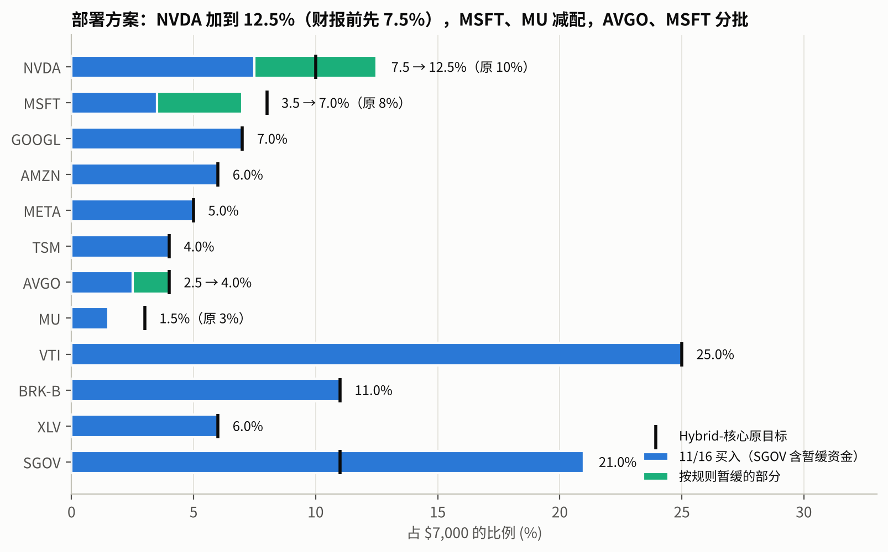
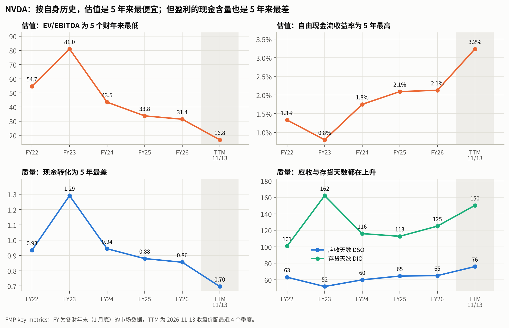
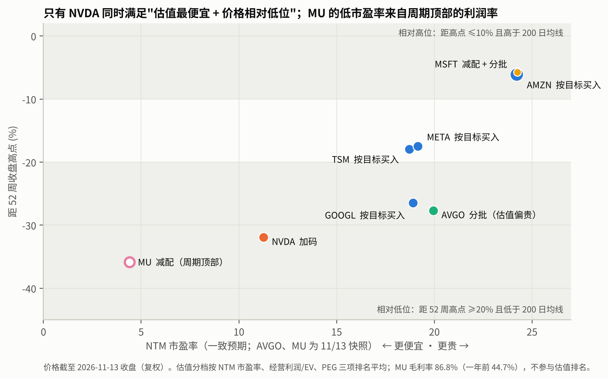

# Claude 分析 2026-11-15：买入时机 = 会计估值 × 相对价格 × 事件

- 价格截至 2026-11-13 收盘（周末无交易）。基本面与一致预期来自 FMP，抓取于 2026-11-16 UTC，原始返回逐字保存在 `data/fmp_raw/`。
- 本文是分析，不是交易指令。我不是持牌投资顾问，也没有执行交易。
- 这是 Hybrid-核心（`hybrid_core_20261114`）的**执行层提案**；Shuai 确认前，`current_plan.json` 不改。

## 0. 结论

**1. "NVDA 是低点、可以加码"：会计数据支持"便宜"，但价格数据不支持"已经见底"。**

- **便宜（证据很一致）**
  - NTM 市盈率 **11.3x**。8 家 AI 里除 MU 外最低，其余为 18.7–24.3x。
  - PEG **0.31**，最低。
  - EV/EBITDA **16.8x**，而 FY22–FY26 各财年末在 31.4–81.0x 之间，是 5 年最低。
  - 自由现金流收益率 **3.2%**，是 5 年最高（此前最高 2.1%）。
  - 按 NTM 市盈率反推，10 年隐含增长只有 **4.0%**；而一致预期 FY29 对 FY28 的 EPS 增长是 +36%。
- **但盈利的现金含量是 5 年最差**
  - 经营现金流/净利润 **0.70**（FY22–FY26 为 0.86–1.29）。
  - 应收天数 DSO 从 65 天升到 **76 天**；存货天数 DIO 从 125 天升到 **150 天**。
  - 非经营收益占税前利润 14%。
  - Q3 指引已不含中国数据中心收入；公司还有最高 $125B 的担保融资计划。
- **价格信号对 NVDA 互相矛盾**（这 8 只股票过去 45 个月的数据，§3）：
  - "离 52 周高点越远，之后 3 个月越好"：rank IC +0.23，t = 3.1，n = 15。
  - "低于 200 日均线越多，之后 1 个月越差"：多空收益 −3.7%/月，t = −1.85。
  - NVDA 现在距高点 −32%，同时低于 200 日均线 20%，两个信号方向相反。
- **判断**：加码有会计依据，但宜加到 **12.5%**（含 VTI 穿透 13.8%，NVDA 占组合风险 30%），并以 11/17 财报为条件分两步买。超过 15% 就回到 conviction8 的集中度（风险占比 36%）。

**2. 哪些"相对高点"该暂缓：只有估值也贵的时候才暂缓。**

- **MSFT**：同时是"最贵"和"相对高位"，减配 1pp 并分批。
  - 最贵：NTM 市盈率 24.3x、PEG 1.05、经营利润/EV 4.1%。
  - 相对高位：距高点 −5.7%，高于 200 日均线 19%。
- **AMZN、BRK-B、XLV**：价格在高位，但估值不贵或属于防御仓，按目标买入。在本样本里，单看价格不是可靠的择时信号。

**3. MU 市盈率 4.4x 看着最便宜，其实是周期顶部的利润率，减配到 1.5%。**

- FQ4 FY26 毛利率 86.8%，一年前为 44.7%。管理层指引 FQ1 FY27 毛利率约 86.25%，并称这是 FY27 的低点。
- 市场按利润将回落定价（隐含增长 −11.9%）。
- 对周期股，低市盈率出现在利润顶点，不能当作"便宜"。

**4. AVGO 估值最贵，但价格不高，维持 4%，分批买。**

- 估值：经营利润/EV 2.6%，EV/EBITDA 约 32x，隐含增长 13.8% 是最高的。
- 价格：距 6/2 高点 −28%。
- 买法：先买 2.5%，12 月财报后再补 1.5%。

## 1. 方案

| 资产 | Hybrid-核心 | **时机目标** | **11/16 买入** | 暂缓 | 暂缓部分何时买 |
|---|---:|---:|---:|---:|---|
| NVDA | 10% | **12.5%** · $875 | **7.5%** · $525 | 5% | 11/17 财报后：营收 ≥ $108B、毛利率 ≥ 73.5%、FY28 框架不变则补；否则停在 7.5% |
| MSFT | 8% | **7%** · $490 | **3.5%** · $245 | 3.5% | 12/31 季度再平衡时，或提前跌破 200 日均线时 |
| GOOGL | 7% | 7% · $490 | 7% | – | |
| AMZN | 6% | 6% · $420 | 6% | – | |
| META | 5% | 5% · $350 | 5% | – | |
| TSM | 4% | 4% · $280 | 4% | – | |
| AVGO | 4% | 4% · $280 | **2.5%** · $175 | 1.5% | 12 月财报后，除非 AI 指引下调 |
| MU | 3% | **1.5%** · $105 | 1.5% | – | 下一次季度复核再议 |
| VTI | 25% | 25% · $1,750 | 25% | – | |
| BRK-B | 11% | 11% · $770 | 11% | – | |
| XLV | 6% | 6% · $420 | 6% | – | |
| SGOV | 11% | 11% · $770 | **21%** · $1,470 | | 含暂缓资金 |

- AI 8 家合计仍是 47%。资金是从 MU（−1.5pp）和 MSFT（−1pp）挪到 NVDA（+2.5pp）。
- 风险（3 年协方差，发行人层面，含 VTI 穿透）：

| | 波动 | NVDA 穿透 | NVDA 风险贡献 | AI 8 家穿透 | NVDA 单独再跌 30% | 现金 |
|---|---:|---:|---:|---:|---:|---:|
| Hybrid-核心 | 17.5% | 11.3% | 24.3% | 52.9% | −3.4% | 11% |
| **时机目标** | **17.6%** | **13.8%** | **30.3%** | **52.9%** | **−4.1%** | 11% |
| 11/16 当天持仓 | 14.6% | 8.8% | 21.8% | 42.9% | −2.6% | 21% |



## 2. 方法（规则全部写在 `timing_20261115.py`）

1. **价格位置**（复权收盘价）
   - 相对低位：距 52 周收盘高点 ≥20%，且低于 200 日均线。
   - 相对高位：距高点 ≤10%，且高于 200 日均线。
   - 其余为中间。
2. **会计估值**
   - **NTM 市盈率**：FMP 一致预期，按当前财年剩余天数混合 FY1 和 FY2 的 EPS。
   - **经营利润/EV**：经营利润率 ÷ EV/Sales。剔除非经营收益和资本结构的影响；GOOGL 有 45% 的税前利润来自非经营项目，AMZN 有 40%。
   - **PEG**：NTM 市盈率 ÷（FY3/FY2 的 EPS 增长 × 100）。
   - 三项在 7 家非周期公司中各自排名后取平均：≤3 为便宜，≤5 为中等，>5 为贵。
   - **口径处理**：TSM 的 FMP 数据是台股 TWD 口径，按 11/13 快照的 ADR/台股市盈率之比折算，ADR 溢价约 17%。AVGO 和 MU 的 FMP 访问被套餐拒绝，改用 11/13 快照（stockanalysis，FY1/NTM 口径未冻结）。
3. **动作规则**

   | 情形 | 动作 |
   |---|---|
   | 便宜 × 相对低位 | 加码 |
   | 贵 × 相对高位 | 减配 + 分批 |
   | 贵（不论价格） | 分批 |
   | 周期顶部（MU） | 减配 |
   | 其余 | 按目标 |

   - 价格位置只有和估值同向时才起作用（原因见 §3）。
   - 加减配幅度：NVDA +2.5pp，相当于 NVDA 旋钮的一档（风险占比约 +6pp）；资金来自 MU −1.5pp、MSFT −1pp。这些幅度是判断，不是优化结果。
4. **事件**：信息事件之前只买一部分，这是在利用信息价值，不是为了提高期望收益。
   - NVDA 11/17 财报：期权隐含约 ±10.6%。
   - AVGO、MU：12 月财报。

## 3. 证据

**8 家 AI 的会计与价格**（`out/timing_table_ai8.csv`；AVGO、MU 的估值来自 11/13 快照）

| | NTM 市盈率 | 经营利润/EV | PEG | 隐含 10 年增长 | FCF 收益率 | 经营现金流/净利润 | 非经营占税前 | 资本开支/收入 | 距 52 周高点 | 相对 200 日均线 | 估值分档 | 价格分档 |
|---|---:|---:|---:|---:|---:|---:|---:|---:|---:|---:|---|---|
| NVDA | **11.3** | 5.0% | **0.31** | **4.0%** | 3.2% | **0.70** | 14% | 2.4% | **−31.9%** | **−20.1%** | 便宜 | 低位 |
| TSM | 18.7 | 5.1% | 0.68 | 10.8% | 2.4% | 1.19 | 6% | 34.6% | −17.9% | −0.7% | 便宜 | 中间 |
| GOOGL | 18.9 | 4.3% | 0.89 | 6.7% | 0.5% | 0.76 | **45%** | 33.9% | −26.4% | −12.5% | 中等 | 低位 |
| META | 19.1 | 4.6% | 1.11 | 8.9% | 1.7% | 1.77 | −1% | 43.2% | −17.5% | +1.9% | 中等 | 中间 |
| AVGO | 19.9 | **2.6%** | – | **13.8%** | 2.4% | – | – | 1.4% | −27.7% | −5.3% | 贵 | 低位 |
| AMZN | 24.2 | 3.4% | 0.67 | 12.3% | **−1.6%** | 1.25 | **40%** | 27.0% | −6.1% | +9.0% | 中等 | 高位 |
| MSFT | **24.3** | 4.1% | 1.05 | 9.4% | 1.5% | 1.37 | 8% | 39.2% | **−5.7%** | **+18.9%** | 贵 | 高位 |
| MU | 4.4 | 12.2% | – | −11.9% | 6.7% | – | – | 23.1% | −35.8% | +1.7% | 周期顶部 | 中间 |

**读法**
- 云厂商的资本开支占收入 27–43%，自由现金流收益率只有 −1.6% 到 1.7%。它们的资本开支就是 NVDA 的收入，所以"云厂商的现金流能否继续支撑资本开支"是整条 AI 链共同的风险。
- META 的有效税率只有 4.6%，抬高了净利润；按正常税率算，市盈率会更高。

**NVDA 与自身历史对比**（`out/nvda_own_history.csv`）



**时机地图**



**历史检验：在这 8 只股票上，"买回撤"有效吗？**（`out/timing_signal_ic_monthly.csv`）
- 每月末按信号给 8 只股票排序，看之后 1 个月和 3 个月的收益；3 个月用不重叠的观测。样本为 2022-11 至 2026-08，共 45 个月。

| 信号 | 1 个月 rank IC | t | 3 个月 rank IC（不重叠） | t | 多空（前 2 − 后 2）每月 | t |
|---|---:|---:|---:|---:|---:|---:|
| 距 52 周高点的回撤（越深越先买） | +0.09 | 1.55 | **+0.23** | **3.08** | +1.0% | 0.59 |
| 低于 200 日均线的程度（越低越先买） | −0.04 | −0.55 | −0.12 | −1.42 | **−3.7%** | **−1.85** |
| 12-1 动量 | +0.04 | 0.69 | +0.08 | 0.84 | +1.3% | 0.67 |

- 结论：在这个样本里，"离高点远"有一定均值回归，但"仍处于下跌趋势"会继续拖累。NVDA 两者都占，价格本身给不出明确的买点。
- 局限：样本只有 8 只股票，期间是 AI 牛市，统计功效很低。所以价格只作为估值的配合条件。

## 4. 局限

1. **数据可得性**
   - FMP 套餐拒绝了 AVGO/MU 的基本面和预期、季度序列和汇率数据，所以 NVDA 只有财年末加 TTM 的历史。
   - Financial Datasets 账户余额为 0，本轮没有使用。
2. **一致预期会变**：NVDA FY28 EPS 预期的最高与最低值相差均值的 19.6%（相对均值 −11% 到 +8%）；11/17 之后可能大幅修正，所以 NVDA 的后半部分要等财报。
3. **规则含判断**：估值分档阈值、加减配幅度、"7.5% 先买"的比例都是判断，不是最优化的结果，也未经样本外检验。
4. **执行**：没有计税费和价差；小额仓位需要零股交易；周一的价格会和 11/13 不同。

## 5. 文件与复现

```
python3 -I claude_analysis_20261115/timing_20261115.py .
python3 -I claude_analysis_20261115/make_figures_20261115.py .
```

- 输入：
  - `data/fmp_raw/*.json`：FMP 原始返回，逐字保存。
  - `data/sources_web_20261115.json`：MU 财报与 NVDA 事件的网页来源。
  - GPT 包的价格：按其 MANIFEST 核对 SHA-256。
  - `claude_analysis_20261113/out_valuation.csv`：只用于 AVGO 和 MU。
  - `claude_analysis_20261114/out/summary.json`：Hybrid 权重与 VTI 穿透。
- 输出：`out/`、`figures/`、`manifest.json`（SHA-256）。

## 6. 来源

- FMP（Financial Modeling Prep）：key-metrics-ttm、metrics-ratios-ttm、financial-estimates、NVDA key-metrics（annual）、NVDA quote。原文见 `data/fmp_raw/`。
- Micron FQ4 FY26：<https://www.marketbeat.com/instant-alerts/transcript-micron-technology-q4-earnings-call-highlights-2026-09-30/> ；<https://www.blocksandfiles.com/flash/2026/10/01/memory-gold-rush-bonanza-makes-billions-for-micron/5300445> ；<https://beancount.io/blog/2026/10/02/micron-fy2026-q4-earnings-analysis>
- NVDA Q3 FY27 事件与指引：<https://www.marketpulse.com/markets/nvidia-nvda-q3-earnings-preview-ai-spending-risks-and-governance-concerns-threaten-major-uptrend/> ；<https://www.trefis.com/data/companies/NVDA?from=NOK-2026-05-26> ；<https://nvidianews.nvidia.com/news/nvidia-sets-conference-call-for-third-quarter-financial-results-6928873>
