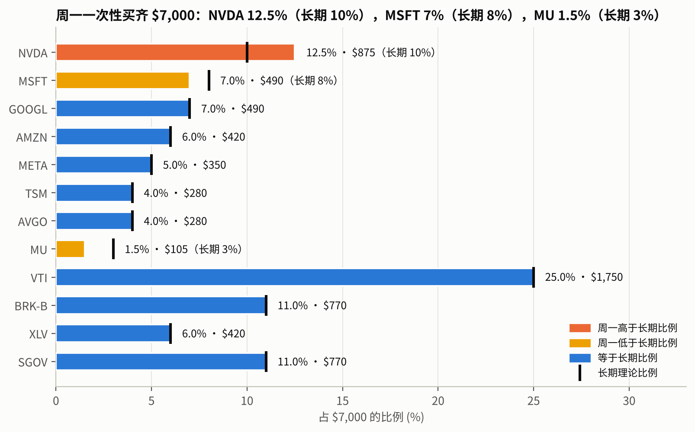

# Claude 分析 2026-11-15：周一一次性买入比例与长期理论比例（会计估值 × 相对价格）

- 价格截至 2026-11-13 收盘（周末无交易）。基本面与一致预期来自 FMP，抓取于 2026-11-16 UTC，原始返回逐字保存在 `data/fmp_raw/`。
- 用户决定 **周一（2026-11-16）一次性买齐全部 $7,000，不分批**。本文给出两组比例：
  - **周一买入比例**：长期比例加上估值倾斜。
  - **长期理论比例**：即 Hybrid-核心，作为以后再平衡的中性点。
- 本文是分析，不是交易指令。我不是持牌投资顾问，也没有执行任何交易。

## 0. 结论

**1. "NVDA 是低点、可以加码"：会计数据支持"便宜"，但价格数据不支持"已经见底"。**

- **便宜**
  - NTM 市盈率 **11.3x**。8 家 AI 里除 MU 外最低，其余为 18.7–24.3x。
  - PEG **0.31**，最低。
  - EV/EBITDA **16.8x**，FY22–FY26 各财年末在 31.4–81.0x 之间，是 5 年最低。
  - 自由现金流收益率 **3.2%**，是 5 年最高。
  - 按 NTM 市盈率反推，10 年隐含增长只有 **4.0%**；而一致预期 FY29 对 FY28 的 EPS 增长是 +36%。
- **但盈利的现金含量是 5 年最差**
  - 经营现金流/净利润 **0.70**（FY22–FY26 为 0.86–1.29）。
  - 应收天数 DSO 从 65 天升到 **76 天**；存货天数 DIO 从 125 天升到 **150 天**。
  - 非经营收益占税前利润 14%。
  - Q3 指引已不含中国数据中心收入；公司还有最高 $125B 的担保融资计划。
- **价格信号对 NVDA 互相矛盾**（这 8 只股票过去 45 个月的数据，§3）：
  - "离 52 周高点越远，之后 3 个月越好"：rank IC +0.23，t = 3.1，n = 15。
  - "低于 200 日均线越多，之后 1 个月越差"：多空收益 −3.7%/月，t = −1.85。
  - NVDA 距高点 −32%，同时低于 200 日均线 20%，两个信号方向相反。
- **判断**：周一按 **12.5%** 买入 NVDA（长期比例 10%）。加码有会计依据。代价是 NVDA 占组合风险从 24% 升到 30%；超过 15% 就会回到 conviction8 的集中度（风险占比 36%）。

**2. "相对高点"只在估值也贵时才少买。**

- **MSFT**：同时是"最贵"和"相对高位"，周一按 **7%** 买入（长期 8%）。
  - 最贵：NTM 市盈率 24.3x、PEG 1.05、经营利润/EV 4.1%。
  - 相对高位：距高点 −5.7%，高于 200 日均线 19%。
- **AMZN、BRK-B、XLV**：价格在高位，但估值不贵或属于防御仓，按长期比例买入。在本样本里，单看价格不是可靠的择时信号。

**3. MU：市盈率 4.4x 是周期顶部的利润率，周一按 1.5% 买入（长期 3%）。**

- FQ4 FY26 毛利率 86.8%，一年前为 44.7%。管理层指引 FQ1 FY27 毛利率约 86.25%，并称这是 FY27 的低点。
- 市场按利润将回落定价（隐含增长 −11.9%）。

**4. AVGO：估值最贵，但价格不高，按长期比例 4% 买入，不加码。**

- 估值：经营利润/EV 2.6%，EV/EBITDA 约 32x，隐含增长 13.8% 是最高的。
- 价格：距 6/2 高点 −28%。

## 1. 周一买入与长期比例

| 资产 | **长期理论比例** | **周一买入比例** | **周一买入金额** | 约合股数（按 11/13 收盘） | 偏离长期的原因 |
|---|---:|---:|---:|---:|---|
| NVDA | 10% | **12.5%** | **$875** | 5.37 | 估值便宜 × 相对低位 |
| MSFT | 8% | **7%** | **$490** | 0.94 | 估值最贵 × 相对高位 |
| GOOGL | 7% | 7% | $490 | 1.66 | |
| AMZN | 6% | 6% | $420 | 1.58 | |
| META | 5% | 5% | $350 | 0.55 | |
| TSM | 4% | 4% | $280 | 0.70 | |
| AVGO | 4% | 4% | $280 | 0.81 | |
| MU | 3% | **1.5%** | **$105** | 0.13 | 周期顶部利润率 |
| VTI | 25% | 25% | $1,750 | 4.72 | |
| BRK-B | 11% | 11% | $770 | 1.30 | |
| XLV | 6% | 6% | $420 | 2.22 | |
| SGOV | 11% | 11% | $770 | 7.66 | |
| **合计** | **100%** | **100%** | **$7,000** | | |

- AI 8 家合计在两组比例里都是 47%。周一只是把 MU 的 1.5pp 和 MSFT 的 1pp 挪给了 NVDA。
- 股数按 11/13 收盘价估算，周一实际成交价会不同，以金额为准。多数仓位需要零股交易；如果券商只支持整股，按金额就近取整，误差放进 SGOV。
- 风险（3 年协方差，发行人层面，含 VTI 穿透，`out/timing_plan_risk.csv`）：

| | 波动 | NVDA 穿透 | NVDA 风险贡献 | AI 8 家穿透 | NVDA 单独再跌 30% | NVDA 财报日 ±10.6% 对组合的影响 |
|---|---:|---:|---:|---:|---:|---:|
| 长期理论比例 | 17.5% | 11.3% | 24.3% | 52.9% | −3.4% | ±1.2% |
| **周一买入比例** | **17.6%** | **13.8%** | **30.3%** | **52.9%** | **−4.1%** | **±1.5%** |

- 一次性买入意味着持有 12.5% 的 NVDA 过 11/17 财报，期权隐含波动约 ±10.6%，对组合的影响约 ±1.5%。



### 1.1 之后怎么回到长期比例

1. **11/17 财报后，只在基本面变化时动 NVDA**。出现以下任一情况，把 NVDA 从 12.5% 降到 7.5%，5pp 按 ERC 比例分给其余 7 家 AI（AI 总量不变）：
   - 营收低于 $105.8B（指引下限）；
   - Q4 毛利率指引低于 71%；
   - FY28 增长框架被撤回或下调；
   - 出现专门针对 NVIDIA 数据中心销售的新出口限制；
   - 永久 CEO 搜寻伴随路线图或客户承诺的变化。

   否则不动。只有价格涨跌、没有基本面变化，不触发任何调整。
2. **季度复核**（首次在 2026-12-31）：用新价格和新基本面重跑 `timing_20261115.py`。
   - 倾斜只在信号仍成立时保留：NVDA 仍便宜且不在相对高位；MU 仍是周期顶部；MSFT 仍又贵又在高位。
   - 信号不成立的仓位，以及其余所有仓位，恢复到长期比例。

## 2. 方法（规则全部写在 `timing_20261115.py`）

1. **价格位置**（复权收盘价）
   - 相对低位：距 52 周收盘高点 ≥20%，且低于 200 日均线。
   - 相对高位：距高点 ≤10%，且高于 200 日均线。
   - 其余为中间。
2. **会计估值**
   - **NTM 市盈率**：FMP 一致预期，按当前财年剩余天数混合 FY1 和 FY2 的 EPS。
   - **经营利润/EV**：经营利润率 ÷ EV/Sales。剔除非经营收益和资本结构的影响；GOOGL 有 45% 的税前利润来自非经营项目，AMZN 有 40%。
   - **PEG**：NTM 市盈率 ÷（FY3/FY2 的 EPS 增长 × 100）。
   - 三项在 7 家非周期公司中各自排名后取平均：≤3 为便宜，≤5 为中等，>5 为贵。
   - **口径处理**：TSM 的 FMP 数据是台股 TWD 口径，按 11/13 快照的 ADR/台股市盈率之比折算，ADR 溢价约 17%。AVGO 和 MU 的 FMP 访问被套餐拒绝，改用 11/13 快照（stockanalysis，FY1/NTM 口径未冻结）。
3. **倾斜规则**

   | 情形 | 动作 |
   |---|---|
   | 便宜 × 相对低位 | 加码 |
   | 贵 × 相对高位 | 减配 |
   | 周期顶部 | 减配 |
   | 其余（含"贵但价格不高"） | 按长期比例 |

   - 价格位置只有和估值同向时才起作用（原因见 §3）。
   - 幅度：NVDA +2.5pp，即 NVDA 旋钮一档，风险占比约 +6pp；资金来自 MU −1.5pp、MSFT −1pp。这些幅度是判断，不是优化结果。

## 3. 证据

**8 家 AI 的会计与价格**（`out/timing_table_ai8.csv`；AVGO、MU 的估值来自 11/13 快照）

| | NTM 市盈率 | 经营利润/EV | PEG | 隐含 10 年增长 | FCF 收益率 | 经营现金流/净利润 | 非经营占税前 | 资本开支/收入 | 距 52 周高点 | 相对 200 日均线 | 估值分档 | 价格分档 |
|---|---:|---:|---:|---:|---:|---:|---:|---:|---:|---:|---|---|
| NVDA | **11.3** | 5.0% | **0.31** | **4.0%** | 3.2% | **0.70** | 14% | 2.4% | **−31.9%** | **−20.1%** | 便宜 | 低位 |
| TSM | 18.7 | 5.1% | 0.68 | 10.8% | 2.4% | 1.19 | 6% | 34.6% | −17.9% | −0.7% | 便宜 | 中间 |
| GOOGL | 18.9 | 4.3% | 0.89 | 6.7% | 0.5% | 0.76 | **45%** | 33.9% | −26.4% | −12.5% | 中等 | 低位 |
| META | 19.1 | 4.6% | 1.11 | 8.9% | 1.7% | 1.77 | −1% | 43.2% | −17.5% | +1.9% | 中等 | 中间 |
| AVGO | 19.9 | **2.6%** | – | **13.8%** | 2.4% | – | – | 1.4% | −27.7% | −5.3% | 贵 | 低位 |
| AMZN | 24.2 | 3.4% | 0.67 | 12.3% | **−1.6%** | 1.25 | **40%** | 27.0% | −6.1% | +9.0% | 中等 | 高位 |
| MSFT | **24.3** | 4.1% | 1.05 | 9.4% | 1.5% | 1.37 | 8% | 39.2% | **−5.7%** | **+18.9%** | 贵 | 高位 |
| MU | 4.4 | 12.2% | – | −11.9% | 6.7% | – | – | 23.1% | −35.8% | +1.7% | 周期顶部 | 中间 |

**读法**
- 云厂商的资本开支占收入 27–43%，自由现金流收益率只有 −1.6% 到 1.7%。它们的资本开支就是 NVDA 的收入，所以"云厂商的现金流能否继续支撑资本开支"是整条 AI 链共同的风险。
- META 的有效税率只有 4.6%，抬高了净利润。

**NVDA 与自身历史对比**（`out/nvda_own_history.csv`）


**时机地图**


**历史检验：在这 8 只股票上，"买回撤"有效吗？**（`out/timing_signal_ic_monthly.csv`）
- 每月末按信号给 8 只股票排序，看之后 1 个月和 3 个月的收益；3 个月用不重叠的观测。样本为 2022-11 至 2026-08，共 45 个月。

| 信号 | 1 个月 rank IC | t | 3 个月 rank IC（不重叠） | t | 多空（前 2 − 后 2）每月 | t |
|---|---:|---:|---:|---:|---:|---:|
| 距 52 周高点的回撤（越深越先买） | +0.09 | 1.55 | **+0.23** | **3.08** | +1.0% | 0.59 |
| 低于 200 日均线的程度（越低越先买） | −0.04 | −0.55 | −0.12 | −1.42 | **−3.7%** | **−1.85** |
| 12-1 动量 | +0.04 | 0.69 | +0.08 | 0.84 | +1.3% | 0.67 |

- 结论：在这个样本里，"离高点远"有一定均值回归，但"仍处于下跌趋势"会继续拖累。NVDA 两者都占，价格本身给不出明确的买点。
- 局限：样本只有 8 只股票，期间是 AI 牛市，统计功效很低。所以价格只作为估值的配合条件。

## 4. 局限

1. **数据可得性**
   - FMP 套餐拒绝了 AVGO/MU 的基本面和预期、季度序列和汇率数据，所以 NVDA 只有财年末加 TTM 的历史。
   - Financial Datasets 账户余额为 0，本轮没有使用。
2. **一致预期会变**：NVDA FY28 EPS 预期的最高与最低值相差均值的 19.6%（相对均值 −11% 到 +8%），11/17 之后可能大幅修正。
3. **规则含判断**：估值分档阈值和加减配幅度都是判断，不是最优化的结果，也未经样本外检验。
4. **执行**：没有计税费和价差；周一的价格会和 11/13 不同。

## 5. 文件与复现

```
python3 -I claude_analysis_20261115/timing_20261115.py .
python3 -I claude_analysis_20261115/make_figures_20261115.py .
```

- 输入：
  - `data/fmp_raw/*.json`：FMP 原始返回，逐字保存。
  - `data/sources_web_20261115.json`：MU 财报与 NVDA 事件的网页来源。
  - GPT 包的价格：按其 MANIFEST 核对 SHA-256。
  - `claude_analysis_20261113/out_valuation.csv`：只用于 AVGO 和 MU。
  - `claude_analysis_20261114/out/summary.json`：Hybrid 权重与 VTI 穿透。
- 输出：
  - `out/monday_purchase_7000.csv`：周一买入金额与约合股数。
  - `out/timing_plan_risk.csv`：两组比例的风险对比。
  - `out/timing_table_ai8.csv`：8 家 AI 的估值与价格分档。
  - `out/nvda_own_history.csv`：NVDA 与自身历史对比。
  - `out/timing_signal_ic_monthly.csv`：历史检验的月度数据。
  - `out/summary.json`：关键数字与输入哈希。
  - `figures/`：三张图。
  - `manifest.json`：所有文件的 SHA-256。

## 6. 来源

- FMP（Financial Modeling Prep）：key-metrics-ttm、metrics-ratios-ttm、financial-estimates、NVDA key-metrics（annual）、NVDA quote。原文见 `data/fmp_raw/`。
- Micron FQ4 FY26：<https://www.marketbeat.com/instant-alerts/transcript-micron-technology-q4-earnings-call-highlights-2026-09-30/> ；<https://www.blocksandfiles.com/flash/2026/10/01/memory-gold-rush-bonanza-makes-billions-for-micron/5300445> ；<https://beancount.io/blog/2026/10/02/micron-fy2026-q4-earnings-analysis>
- NVDA Q3 FY27 事件与指引：<https://www.marketpulse.com/markets/nvidia-nvda-q3-earnings-preview-ai-spending-risks-and-governance-concerns-threaten-major-uptrend/> ；<https://www.trefis.com/data/companies/NVDA?from=NOK-2026-05-26> ；<https://nvidianews.nvidia.com/news/nvidia-sets-conference-call-for-third-quarter-financial-results-6928873>
