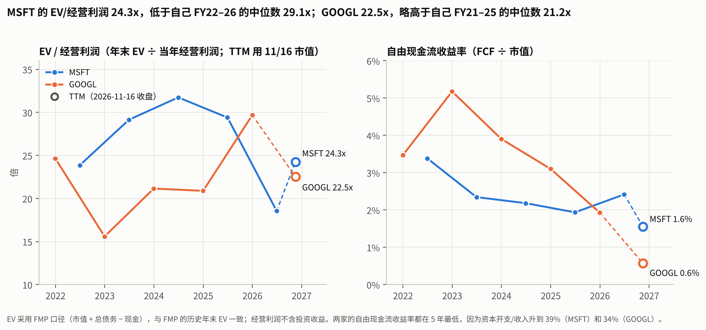
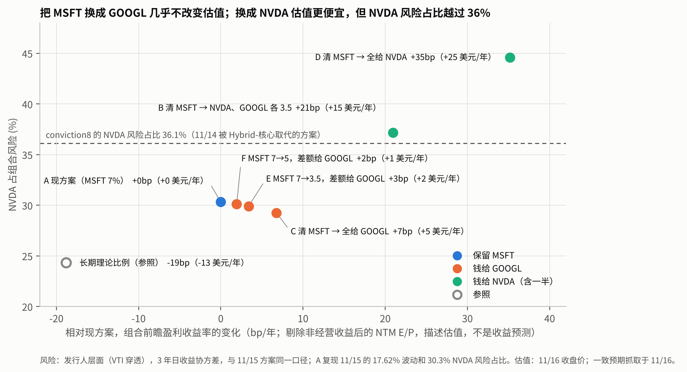

# Claude 分析 2026-11-16：要不要把 MSFT 那一份挪给 NVDA 或 GOOGL？

- **问题**（Shuai，11/16 22:42 ET）：
  - MSFT 整体价位太高，是否干脆把它拆给 NVDA 或 GOOGL；
  - 黄仁勋是否在策划回归 NVIDIA；
  - 最新财报出来了，记得看。
- **数据口径**
  - 价格：2026-11-16 收盘，来自 FMP。AVGO、MU 的报价被套餐拒绝，沿用 11/13。
  - 财报：各公司最新 10-Q。NVDA 是 7/26 结束的 Q2 FY27；Q3 FY27 在 11/17 盘后发布。
  - 一致预期：沿用 11/16 UTC 抓取的 FMP 数据，与 11/15 方案相同。
  - 原始返回逐字保存在 `data/fmp_raw/`，网页事实见 `data/sources_web_20261116.json`。
- 本文是分析，不是交易指令。**`current_plan.json` 未改**，等 Shuai 决定。我不是持牌投资顾问。

## 0. 结论

**1. 黄仁勋"策划回归"：没有查到可信报道。**

- 11/12 的 8-K 写明：
  - 他辞去 President、CEO 和董事，立即生效；
  - CFO Colette Kress 任临时 CEO，同时继续当 CFO；
  - Harvey C. Jones 任董事会首位 Chair；
  - 董事会从内部和外部同时找正式 CEO。
- 公告没有提到他今后的任何角色。
- 网上"回归"的报道，说的是 11/9–11/10 他回总部开会，发生在辞职之前。
- 结论：这不能作为加 NVDA 的理由。

**2. MSFT 贵不贵：横向比贵，和自己比不贵，质量是三家里最好的。**

- **横向比贵**
  - NTM 市盈率 23.9x，三家最高。GOOGL 18.2x，剔除投资收益后 19.5x；NVDA 10.9x。
  - 价格距 52 周高点只有 −6.8%，高于 200 日均线 17.5%，6 月底以来上涨 39%。
  - 11/15 的规则已经把它判为"贵 + 相对高位 → 少买"，周一方案因此从 8% 降到 7%。
- **和自己比不贵**
  - EV/经营利润 24.3x。FY22–26 的中位数是 29.1x，5 个财年末里有 3 个比现在贵。
- **溢价有现金支撑**
  - 经营现金流/净利润 1.37。
  - 非经营收益只占税前利润 8%。
  - 过去 4 季融资现金流 −$57B：分红 $27B，回购 $21B，净还债 $8B。

**3. GOOGL 的"便宜"打了折扣，现金流是三家最差。**

- **报表上的便宜，近一半来自投资收益**
  - 过去 4 季税前利润有 45% 是非经营收益，Q2 一个季度就有 +$98B。
  - FY26 一致预期 EPS $19.63，FY27 只有 $15.03。
  - FMP 的 TTM EV/EBITDA（11/13 价格）11.6x 也被这部分收益压低了；按经营利润 + 折旧摊销重算（11/16 价格）是 19.1x。
- **剔除之后**
  - NTM 市盈率 19.5x。
  - EV/经营利润 20.5x（EV 扣除现金和长期投资），比 MSFT 的 23.8x 便宜约 14%，不是 25%。
  - 和自己比 22.5x，略高于 FY21–25 的中位数 21.2x。
- **现金流**
  - FCF 收益率 0.6%（MSFT 1.6%，NVDA 3.4%）；Q2、Q3 的 FCF 分别为 −$5.9B、−$9.1B。
  - 过去 4 季融资现金流净流入 $123B，其中净发债 $97B。
  - 稀释股数同比 +1.4%，经营现金流/净利润 0.76。
- **有利的一面**
  - Cloud 收入 +103%，Cloud 经营利润率 36.2%。
  - 价格距高点 −29%。11/15 的历史检验里，"离高点越远，之后 3 个月相对越好"有一定证据：IC +0.23，t = 3.1，n = 15。

**4. 组合层面：挪给 GOOGL 几乎不改变估值，挪给 NVDA 会越过集中度红线。**

- MSFT 全部挪给 GOOGL（方案 C）：
  - 组合前瞻盈利收益率只多 7bp，约 $5/年；
  - FCF 收益率反而少 7bp。
- MSFT 全部挪给 NVDA（方案 D）：
  - 盈利收益率多 35bp，约 $25/年；
  - 但 NVDA 风险占比升到 44.6%，超过 conviction8 的 36.1%（11/14 被 Hybrid-核心取代的方案）；
  - 明天财报日 ±10.6% 的波动，对组合的影响从 ±$102 变成 ±$154。

**5. 建议**

- **首选方案 A（现方案）不变。**
- 如果想表达"MSFT 偏贵"的看法，用 **F（MSFT 7→5）** 或 **E（MSFT 7→3.5）**，差额给 GOOGL：
  - 风险几乎不变：波动 +0.06 / +0.12pp，NVDA 风险占比 30.1% / 29.9%；
  - 估值也几乎不变：约 +$1 / +$2 每年。
- 不做 B、D。
- 如果周一已经按原计划买了 MSFT，不建议为这几个百分点卖出再换。换手成本和短期资本利得税，大于每年 $1–2 的估值差。
- NVDA 继续按 11/17 的决策规则处理（见根目录 README）。

**6. 规则复跑的附带发现：TSM 新进入"便宜 × 相对低位"。**

- 背景：TSM 11/16 跌 6.3%，与 NVDA 同日下跌。
- 但 TSM 和 NVDA 高度同向，不在财报前追加，留给 12/31 的季度复核。
- GOOGL 仍是"中等估值 × 低位 → 按长期比例"，不是加码对象。

## 1. 黄仁勋：事实清单

| 日期 | 事件 | 来源 |
|---|---|---|
| 11/8 | 承认婚外情，董事会成立独立调查 | KeenGamer |
| 11/9–11/10 | 回总部开晨会、向高管致歉。这就是"回归"报道的来源 | CNBC，经 Outlook India、NewsBytes 转述 |
| 11/10 | 董事会聘请 Wachtell Lipton 主导调查 | TalkEsport，转述 CNBC |
| 11/11 | WSJ：董事会准备让他离任；Fortune：董事会也可能只削权、不撤职 | Cointelegraph，Fortune |
| 11/12 | **8-K：辞去 CEO 与董事，立即生效**。Kress 任临时 CEO，Jones 任 Chair，内外部搜寻继任者 | SEC |
| 11/17 | Q3 FY27 财报，盘后约 1:20 pm PT | SEC 8-K、公司公告 |
| 11/18 | 众议院三位委员会主席此前要求的闭门简报日期 | KeenGamer |

- 11/16 用中英文搜索过，没有找到"辞职后策划回归"的可信报道。搜索词见 `data/sources_web_20261116.json`。

## 2. 最新财报

**MSFT — FQ1 FY27，9 月季，10/28 发布**

- 收入 $92.3B，+19%。
- 经营利润 $45.9B，+21%；经营利润率 49.8%，去年同季 48.9%。
- Azure $33.2B，+48%。这是首次披露美元金额；上季增速是 +42%。
- 商业 RPO +73%。
- 资本开支：现金口径 $39.4B，含融资租赁 $45.2B。
- FCF $18.6B，同比 −27%。
- 年报 FY2026：收入 $331.8B，+17.8%；经营利润 $155.2B，+20.8%。

**GOOGL — Q3 2026，10/28 发布**

- 收入 $127.6B，+25%；Search & other +12%。
- Cloud $30.7B，+103%；Cloud 经营利润率 36.2%，去年同季 23.7%。
- GAAP EPS $2.12，去年同季 $2.87；本季股权投资净亏损 $8.7B。
- 经营利润 $40.6B：
  - 比去年同季剔除 $3.5B 欧盟罚款后的 $34.7B 高 16.9%；
  - 经营利润率 31.8%，去年剔除罚款为 33.9%。
- 资本开支 $51.4B，FCF −$9.1B。
- 2026 年资本开支指引 $195–205B，2027 年将显著上升。财报次日股价约 −12%。
- 年报 FY2025：收入 $402.8B，+15.1%；经营利润 $129.0B，+14.8%。

**NVDA — 最新已发布的是 Q2 FY27（8/26）；Q3 FY27 明天发**

- Q2 FY27：
  - 收入 $96.2B，+106%；经营利润 $63.7B，+124%；
  - 经营现金流 $24.1B，远低于净利润 $59.7B，因为应收增加 $22.3B；
  - 本季净发债 +$24.8B，同时回购 $19.7B。
- Q3 FY27：
  - 指引 $108B ±2%；
  - 一致预期收入 $108.8B，EPS $2.47；
  - Q4 毛利率指引低点 71–72%。

## 3. 三家公司的会计对比（`out/accounting_ttm_3names.csv`）

| | NVDA | MSFT | GOOGL |
|---|---:|---:|---:|
| 最新季度 | Q2 FY27（7/26） | Q1 FY27（9/30） | Q3 2026（9/30） |
| 收入同比（最新季） | +105.9% | +18.8% | +24.7% |
| 经营利润同比（最新季） | +124.1% | +21.0% | +16.9%¹ |
| 经营利润率：最新季 / 去年同季 | 66.2% / 60.8% | 49.8% / 48.9% | 31.8% / 33.9%¹ |
| 非经营收益占税前（TTM） | 14.0% | 8.1% | **45.4%** |
| 经营现金流 / 净利润（TTM） | 0.70 | **1.37** | 0.76 |
| 资本开支 / 收入（TTM） | 2.4% | 39.2% | 33.9% |
| FCF（TTM） | $127.0B | $60.0B | $19.7B |
| 最近两季 FCF | $48.6B → $21.4B | $19.6B → $18.6B | **−$5.9B → −$9.1B** |
| 融资现金流（TTM） | −$48.5B | −$57.4B | **+$122.8B** |
| 其中净发债 | +$24.8B | −$7.9B | +$96.6B |
| 稀释股数同比 | −1.0% | −0.3% | +1.4% |
| FCF 收益率（11/16 市值） | **3.4%** | 1.6% | 0.6% |
| EV / 经营利润（经营 EV²） | **18.5x** | 23.8x | 20.5x |
| NTM 市盈率：一致预期 / 剔除非经营³ | **10.8x / 10.9x** | 23.9x / 23.9x | 18.2x / 19.5x |
| FY2 一致预期 EPS 分歧（高−低）/ 均值 | 19.6% | 10.9% | 26.0% |
| 距 52 周收盘高点 / 相对 200 日均线 | −34.7% / −23.4% | −6.8% / +17.5% | −29.4% / −16.0% |

1. GOOGL 去年同季的基数剔除了 $3.5B 欧盟罚款，即 $34.7B（公司 8-K）。含罚款时，经营利润同比 +29.9%。
2. 经营 EV = 市值 + 总债务 + 优先股 − 现金与短期投资 − 长期投资（按账面）。经营利润不含投资收益，所以 EV 也扣掉投资。
3. 剔除方法：FY1 里已经公布的季度，其非经营项目按 21% 税率扣除后从 FY1 EPS 中减掉：
   - GOOGL 3 个季度，每股 −$8.20；
   - NVDA 2 个季度，每股 −$0.78；
   - MSFT 1 个季度，每股 −$0.004。
   - 然后按剩余天数与 FY2 混合。FY2 一致预期假定不含非经营项目。GOOGL 的分歧 26% 提示，部分分析师的数字可能含有。

## 4. 和自己的历史比（`out/own_history_ev_ebit.csv`）



EV 用 FMP 口径（市值 + 总债务 − 现金），与 FMP 的历史年末 EV 一致。所以这里的 TTM 倍数和 §3 的"经营 EV"不同。

| | 财年末 EV/经营利润 | TTM（11/16） | 有几个财年末比现在贵 | FCF 收益率：财年末区间 → TTM | 经营现金流/净利润：财年末最低 → TTM | 资本开支/收入：财年末最高 → TTM |
|---|---|---:|---:|---|---|---|
| MSFT | FY22–26：23.9、29.1、31.7、29.4、18.5（中位 29.1） | **24.3x** | 3 / 5 | 1.9–3.4% → 1.6% | 1.21 → 1.37 | 34.9% → 39.2% |
| GOOGL | FY21–25：24.6、15.6、21.2、20.9、29.7（中位 21.2） | **22.5x** | 2 / 5 | 1.9–5.2% → 0.6% | 1.21 → **0.76** | 22.7% → 33.9% |

## 5. 11/15 规则在 11/16 收盘价下复跑（`out/cross_section_20261116.csv`）

规则和阈值与 `claude_analysis_20261115/timing_20261115.py` 完全相同。

| | NTM 市盈率 | 经营利润/EV | PEG | 距高点 | 相对 200 日均线 | 估值分档 | 价格分档 | 11/16 动作 | 11/15 动作 |
|---|---:|---:|---:|---:|---:|---|---|---|---|
| NVDA | 10.8 | 5.2% | 0.30 | −34.7% | −23.4% | 便宜 | 低位 | 加码 | 加码 |
| TSM | 17.5 | 5.5% | 0.64 | −23.1% | −7.1% | 便宜 | 低位 | **加码** | 按长期比例 |
| GOOGL | 18.2 | 4.4% | 0.86 | −29.4% | −16.0% | 中等 | 低位 | 按长期比例 | 按长期比例 |
| META | 18.7 | 4.7% | 1.09 | −19.4% | −0.5% | 中等 | 中间 | 按长期比例 | 按长期比例 |
| AVGO⁴ | 19.9 | 2.6% | – | −27.7% | −5.3% | 贵 | 低位 | 按长期比例（不加） | 同左 |
| AMZN | 23.4 | 3.5% | 0.65 | −9.2% | +5.3% | 中等 | 高位 | 按长期比例 | 按长期比例 |
| MSFT | 23.9 | 4.1% | 1.04 | −6.8% | +17.5% | 贵 | 高位 | **减配** | 减配 |
| MU⁴ | 4.4 | 12.2% | – | −35.8% | +1.7% | 周期顶部 | 中间 | 减配 | 减配 |

4. AVGO、MU 为 11/13 数据。

- **TSM**：用 11/15 的 TWD/ADR 折算，再按 ADR 价格缩放。
- **META、AMZN**：一致预期 EPS 按 11/16 重新混合，经营利润/EV 按价格缩放。
- 用剔除后的 19.5x 代替 GOOGL 的 18.2x，GOOGL 的排名平均从 3.67 变为 4.0，仍是"中等"。AMZN 也有 40% 的非经营占比，本文没有它的季度报表，未做剔除。

## 6. 方案对比（$7,000；`out/reallocation_options.csv`）



| 方案 | NVDA / MSFT / GOOGL | 波动 | NVDA 风险占比 | GOOGL 穿透 | 相对长期比例的跟踪误差 | 盈利收益率变化 | FCF 收益率变化 | NVDA 财报日 ±10.6% | NVDA 单独 −30% |
|---|---|---:|---:|---:|---:|---:|---:|---:|---:|
| **A 现方案** | 12.5 / 7 / 7 | 17.62% | 30.3% | 8.1% | 1.05% | — | — | ±$102 | −$289 |
| B 清 MSFT → 各半 | 16 / 0 / 10.5 | 18.58% | **37.2%** | 11.6% | 2.78% | +21bp（+$15） | +3bp | ±$128 | −$363 |
| C 清 MSFT → GOOGL | 12.5 / 0 / 14 | 17.93% | 29.2% | **15.1%** | 2.58% | +7bp（+$5） | −7bp | ±$102 | −$289 |
| D 清 MSFT → NVDA | 19.5 / 0 / 7 | 19.35% | **44.6%** | 8.1% | 3.76% | +35bp（+$25） | +13bp | **±$154** | **−$436** |
| E MSFT 7→3.5 | 12.5 / 3.5 / 10.5 | 17.74% | 29.9% | 11.6% | 1.60% | +3bp（+$2） | −3bp | ±$102 | −$289 |
| F MSFT 7→5 | 12.5 / 5 / 9 | 17.68% | 30.1% | 10.1% | 1.27% | +2bp（+$1） | −2bp | ±$102 | −$289 |
| 长期理论比例（参照） | 10 / 8 / 7 | 17.45% | 24.3% | 8.1% | 0 | −19bp | −7bp | ±$84 | −$237 |

**计算口径**
- 风险：发行人层面，含 VTI 穿透；3 年日收益协方差，与 11/15 同一口径。脚本断言 A 复现 11/15 的 17.62% 和 30.3%。
- 估值变化 = Σ 权重变化 × 剔除后的 NTM E/P（或 FCF 收益率）。这只是估值水平，不是收益预测：NVDA 的高 E/P 部分反映了市场对增长持续性和公司治理的疑虑。
- 删掉 MSFT 后，VTI 里仍有约 1.3% 的 MSFT 穿透。

## 7. 口径与局限

1. **NVDA 的数据今晚就会过时**：资产负债表是 7/26 的，明天的财报会改变它的所有 TTM 数字。
2. **经营 EV 按账面扣除长期投资**：
   - MSFT 约 27% 的 OpenAI 股权，在 2025 年 10 月重组时估值约 $135B，但 MSFT 全部长期投资的账面值只有 $37.8B。
   - GOOGL 的非上市股权按可观察交易重估，账面更接近市价，这也正是它非经营收益的来源。
   - 因此"GOOGL 比 MSFT 便宜约 14%"是上限。若按 2025 年 10 月的 $135B 扣除 OpenAI 股权（其账面值未单独列示，最多 $37.8B），MSFT 的经营 EV 再减 $97–135B，EV/经营利润降到 22.9–23.2x，差距约 11–12%。
3. **剔除 EPS 的方法**：非经营项目统一按 21% 税率处理，包含净利息收入。GOOGL 每季 $0.2–0.9B 的净利息收入也被剔除，剔除后的 EPS 略偏低。
4. **复跑的精度**：TSM、META、AMZN 是按价格缩放 11/15 的数值；AVGO、MU 用 11/13 价格；因此 §5 是近似复跑。
5. **风险模型不含事件风险**：协方差不包含 CEO 搜寻、董事会调查、国会简报和财报这类事件风险。这正是 B、D 的主要风险，表中低估了它。

## 复现

```bash
python3 -I claude_analysis_20261116/msft_reallocation_20261116.py .
python3 -I claude_analysis_20261116/make_figures_20261116.py .
```

所有输入的 SHA-256 记录在 `out/summary.json` 的 `inputs_sha256` 和 `manifest.json`。

## 文件

| 文件 | 内容 |
|---|---|
| `msft_reallocation_20261116.py` | 会计 TTM、自身历史、规则复跑、方案风险与估值 |
| `make_figures_20261116.py` | 两张图（只读 `out/`） |
| `data/fmp_raw/quotes_close_20261116.json` | 6 只股票的 11/16 收盘报价（AVGO、MU 被拒） |
| `data/fmp_raw/{NVDA,MSFT,GOOGL}_20261116.json` | 季度利润表与现金流量表（5 季）、最新资产负债表；MSFT/GOOGL 另有 5 年年报利润表和 key-metrics |
| `data/sources_web_20261116.json` | 8-K、财报新闻稿及转述来源 |
| `out/accounting_ttm_3names.csv` | §3 |
| `out/own_history_ev_ebit.csv` | §4 |
| `out/cross_section_20261116.csv` | §5 |
| `out/reallocation_options.csv` | §6 |
| `out/summary.json` | 汇总与输入哈希 |
