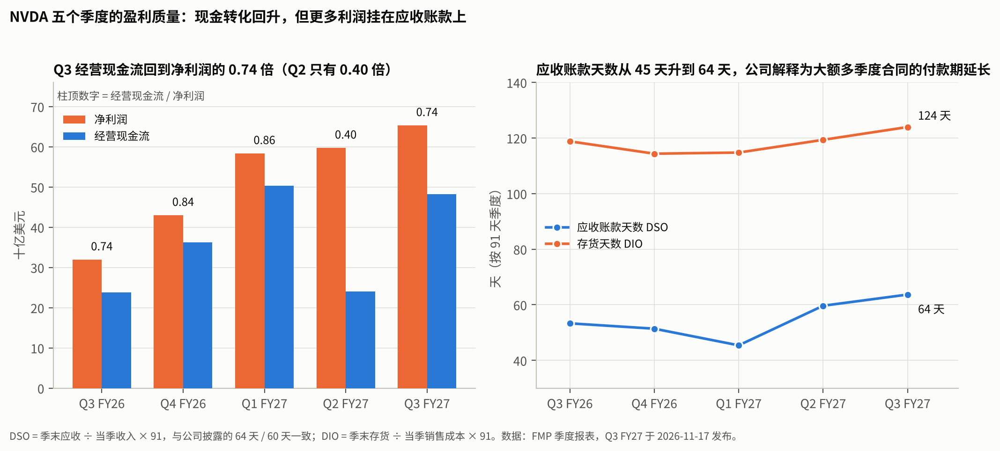

# Claude 分析 2026-11-17：NVDA Q3 FY27 财报后的规则检查

- **时间线**
  - 财报：11/17 16:20 ET 发布；电话会 17:00 ET。
  - 本文数据截至约 17:45 ET。电话会只用到了直播报道，完整文字稿出来后需要再核对。
- **数据来源**
  - FMP 已收录 Q3 FY27 报表，原始返回逐字保存在 `data/fmp_raw/`。
  - 新闻稿、8-K、CFO commentary 和电话会要点，见 `data/sources_web_20261117.json`。
- **规则**
  - 规则写在 `current_plan.json` 的 `decision_rules_nvda_q3fy27_2026_11_17`，是 11/15 预先承诺的。
  - 脚本会核对规则原文里的阈值（$105.8B、71%），再逐条判断。
- 本文不改 `current_plan.json`：规则没有触发，权重不变。我不是持牌投资顾问。

## 0. 结论

**1. 5 条规则都没触发：NVDA 维持 12.5%（$875），到 12/31 季度复核前不动。**

**2. 这个季度本身很强。**
- 收入 $115.8B，比指引中点高 $7.8B。
- Q4 指引 $130.0B ±3%。注意 Q4 是 14 周；粗略按 13 周折算约 $120.7B，环比约 +4%。
- FY28 收入增长展望从约 70% 上调到约 75%。
- 按新指引算，FY28 收入比财报前的一致预期高 6.7%。

**3. 估值：财报后反而略便宜。**
- 剔除非经营收益后的 NTM 市盈率：
  - 收盘价 $155.46 时为 10.1–10.8 倍；
  - 盘后 $157 左右为 10.2–10.9 倍；
  - 区间来自 FY28 用哪个口径（§4）。
- 原因：盈利预期上调的幅度大于股价涨幅。
- TTM 自由现金流收益率 4.0%。

**4. 会计上，利润变"干净"了，但资产负债表对 AI 投资周期的敞口在扩大。**
- **好的一面**
  - 经营现金流/净利润从 Q2 的 0.40 回到 0.74；
  - 非经营收益占税前利润从 10.9% 降到 1.9%。
- **要盯的三项**
  - **应收账款**：季增 28.5%，快于收入的 20.4%；DSO 从 Q1 的 45 天升到 64 天。公司解释是 Rubin 出货节奏，以及大额多季度合同的付款期延长。后者实质上是给客户的信用。
  - **担保**：最大总敞口 $118B，相当于市值的 3.1%、TTM 自由现金流的 0.79 倍、现金及证券的 1.21 倍。其中 $105B 是为 OpenAI 俄亥俄园区给 SB Energy 的信用支持，8 月已披露。最早 FY2029 生效，至今没有付款。
  - **承诺**：供应承诺 $279B → $390B；云服务加租赁 $74B → $102B；另有 $32B 有条件的 neocloud 协议。
- **合起来看**：NVDA 越来越多地用自己的资产负债表支撑客户扩张（担保、更长的付款期、战略投资）。总投资 $57B → $134B，长期债务 $7.5B → $32.4B。需求持续时这是护城河，需求放缓时这些都会变成风险。

**5. 对 MSFT 问题的影响：没有变化。**
- 仍首选 A（现方案）；想表达"MSFT 偏贵"就用 F 或 E。
- 不因为财报好就把 MSFT 挪给 NVDA，原因有二：
  - 规则只规定了下调条件，没有"财报好就加码"的条款；
  - NVDA 已经超配 2.5pp，再加就回到 conviction8 的集中度。

**6. 对 11/16 的更正**：黄仁勋"策划回归"确有 FT 报道，我当时说没有，是错的。见 `claude_analysis_20261116/ERRATA_20261117.md`。董事会已于 11/17 表态不打算让他复职。

## 1. 规则逐条检查（`out/decision_gate.json`）

| 触发条件 | 实际 | 触发？ |
|---|---|---|
| Q3 收入 < $105.8B | $115.8B，高出 $10.0B | 否 |
| Q4 毛利率指引 < 71% | 71.0–72.0%，中点 71.5%，下限正好 71.0%。8 月已预告 Q4 会因内存成本降到 71–72% | 否 |
| FY28 增长框架被撤回或下调 | 上调：约 70% → 约 75%，基数也更高 | 否 |
| 出现专门针对 NVIDIA 数据中心销售的新出口限制 | 没有。Q4 指引照旧不含中国数据中心计算收入。参议院银行委员会要求黄仁勋 12/3 出席听证，Lutnick 12/10；这是听证，不是限制 | 否 |
| CEO 搜寻伴随路线图或客户承诺的变化 | 临时 CEO 称路线图按计划，Vera Rubin NVL72 已出货；董事会不打算让黄仁勋复职；供应和云/租赁承诺都在增加，而不是减少 | 否 |

结论：按 `current_plan.json` 第二条规则，维持 12.5%，持有到季度复核。只有价格变动、没有基本面变化时，也不触发任何动作。

## 2. 季度数字（GAAP，新闻稿与 FMP 一致）

| | Q3 FY27 | Q2 FY27 | Q3 FY26 |
|---|---:|---:|---:|
| 收入 | **$115.8B** | $96.2B | $57.0B |
| 其中数据中心 | $107.6B | — | — |
| 毛利率 | 74.8% | 75.0% | 73.4% |
| 经营利润 | $77.5B | $63.7B | $36.0B |
| 其他收入（非经营） | $1.5B | $7.8B | $1.9B |
| 净利润 | $65.3B | $59.7B | $31.9B |
| 稀释 EPS（GAAP / non-GAAP） | $2.70 / $2.68 | $2.46 / $2.22 | $1.30 / $1.27 |
| 经营现金流 | $48.3B | $24.1B | $23.8B |

- **对比预期**
  - 指引：$108.0B ±2%；
  - LSEG 一致预期：收入 $109.1B，EPS $2.47。
- **Q4 指引**
  - 收入 $130.0B ±3%（14 周，不含中国数据中心计算收入）；
  - 毛利率 71.0–72.0%；
  - GAAP 营业费用约 $11.0B。
- **股东回报**：Q3 回购 $22.1B，分红 $6.0B，合计 $28.1B。9 月追加 $150B 回购授权，剩余 $227.3B。
- **股价**：11/17 收盘 $155.46（−0.4%）。盘后 CNBC 报 16:51 约 +3%；FMP 成交价 17:13 为 $158.37，17:16 为 $157.10。

## 3. 盈利质量：五个季度（`out/nvda_quarterly_quality.csv`）



| | Q3 FY26 | Q4 FY26 | Q1 FY27 | Q2 FY27 | **Q3 FY27** |
|---|---:|---:|---:|---:|---:|
| 经营现金流 / 净利润 | 0.74 | 0.84 | 0.86 | 0.40 | **0.74** |
| 非经营收益占税前 | 5.1% | 12.1% | 23.4% | 10.9% | **1.9%** |
| 应收账款 | $33.4B | $38.5B | $40.7B | $63.1B | **$81.0B** |
| DSO（天） | 53 | 51 | 45 | 60 | **64** |
| 存货天数 DIO | 119 | 114 | 115 | 119 | **124** |
| 应收季增 / 收入季增 | — | 15% / 20% | 6% / 20% | 55% / 18% | **29% / 20%** |
| 投资总额（FMP） | $57.3B | $74.2B | $110.7B | $128.1B | **$134.2B** |
| 长期债务 | $7.5B | $7.5B | $7.5B | $32.4B | **$32.4B** |

- TTM 经营现金流/净利润 0.70，和上一期 TTM 一样。非经营占比从 14.0% 降到 11.7%。TTM FCF $148.7B。
- 我们算的 DSO（季末应收 ÷ 当季收入 × 91）与公司披露的 64 天 / 60 天一致，脚本里有断言。

## 4. 指引隐含的 FY27 / FY28 与估值（`out/summary.json`、`out/nvda_valuation_post_q3.csv`）

以下是对公司指引的算术，不是预测。

| | 财报后（按指引） | 财报前一致预期（FMP，11/16） | 差异 |
|---|---:|---:|---:|
| FY27 收入 | $423.7B（Q1–Q3 实际 + Q4 指引中点） | $410.5B | +3.2% |
| FY28 收入 | $741.4B（FY27 × 1.75） | $694.8B | +6.7% |
| FY27 EPS | $10.36（Q4 推算 $2.81）；剔除非经营 $9.53 | $9.30 | |
| FY28 EPS | $16.81（一致预期按收入同比例放大） | $15.75 | |

| 价格 | NTM 市盈率：财报前口径 | FY27 更新 | FY27 更新 + FY28 放大 |
|---|---:|---:|---:|
| 收盘 $155.46 | 10.8x | 10.7x | 10.1x |
| 盘后 $157.10 | 10.9x | 10.8x | 10.2x |

**口径说明**
- Q4 EPS 的推算假设：
  - 其他收入为 0；
  - 税率 17%（全年指引 16–18% 的中点）；
  - 股数用 Q3 稀释股数。
- "FY28 放大"保持一致预期的利润率不变。它没有计入毛利率降到 71–72% 的影响，也没有计入营业费用增长，所以 10.1–10.2x 是偏乐观的一端。
- FY1 权重 = 距 FY27 年末（2027-01-25）的天数 ÷ 365 = 0.189。

## 5. 资产负债表外：担保与承诺

| 项目 | 金额 | 相对规模 / 说明 |
|---|---:|---|
| 担保最大总敞口 | $118.0B | 市值的 3.1%；TTM FCF 的 0.79 倍；现金及证券 $97.7B 的 1.21 倍 |
| 　其中 SB Energy（OpenAI 俄亥俄园区） | $105.0B | 8/17 的 8-K 已披露；楼宇完工后才生效，最早 FY2029；按 20 年租期递减；至今未付款 |
| 　电力与系统 | $9.5B | |
| 　neocloud 土地、电力与厂房 | $3.5B | |
| 供应承诺 | $390B（上季 $279B） | 主要是多年期内存采购；FY28 部分 $203B，约为隐含 FY28 收入的 27% |
| 云服务 + 未开始的数据中心租赁 | $102B（上季 $74B） | 租期最长 20 年 |
| 有条件的 neocloud 协议 | $32B | 取决于合作方融资和 NVIDIA 验收 |

## 6. 12/31 季度复核的观察清单（提案，待 Shuai 确认后才写进 `current_plan.json`）

现有的复核规则只看估值和价格信号是否仍成立。我建议再加 5 个会计和事件观察项：

1. DSO 超过 70 天，或应收增速连续第二个季度快于收入。
2. Q4 实际毛利率低于 71%（指引下限）。
3. 新增担保或有条件承诺，超出 $118B / $32B。
4. 12/3 参议院听证（黄仁勋）和 12/10（Lutnick）；任何专门针对 NVIDIA 的出口限制提案。
5. 正式 CEO 人选，以及其对路线图和客户协议的表态。

**建议的处理方式**
- 出现 1–3 中的任一项：把 NVDA 的超配（+2.5pp）退回长期比例 10%。
- 4 或 5 落实为出口限制或路线图变化：按原规则降到 7.5%。

这些是建议，还没有被采纳。

## 7. 局限

- 电话会内容来自直播报道，截至约 17:45 ET。"FY28 约 75%"的确切表述，要等文字稿出来再核对。
- FMP 的 Q3 现金流表中，融资部分为空（0），回购和分红用新闻稿数字。
- FMP 的 Q3 FCF 为 $43.831B，公司口径为 $43.777B（差异可能来自融资租赁本金）。季度表统一用 FMP，以便和前几季同口径。
- Q4 按 13 周折算是线性近似，数据中心出货并不均匀。

## 复现

```bash
python3 -I claude_analysis_20261117/nvda_q3fy27_check.py .
python3 -I claude_analysis_20261117/make_figures_20261117.py .
```

所有输入的 SHA-256 记录在 `out/summary.json` 的 `inputs_sha256` 和 `manifest.json`。

## 文件

| 文件 | 内容 |
|---|---|
| `nvda_q3fy27_check.py` | 规则检查、五季度质量、指引算术、表外项目 |
| `make_figures_20261117.py` | 一张图（只读 `out/`） |
| `data/fmp_raw/NVDA_q3fy27_20261117.json` | Q3 FY27 利润表与现金流量表、5 期资产负债表、11/17 收盘与盘后成交 |
| `data/sources_web_20261117.json` | 新闻稿、8-K、电话会、董事会声明、FT 回归报道（勘误用） |
| `out/decision_gate.json` | §1 |
| `out/nvda_quarterly_quality.csv` | §3 |
| `out/nvda_valuation_post_q3.csv` | §4 |
| `out/summary.json` | 汇总与输入哈希 |
