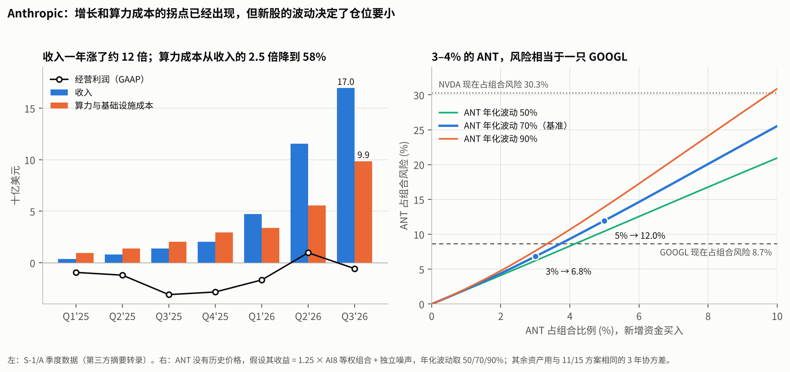

# Claude 分析 2026-11-19：Anthropic（ANT）上市首日的估值与仓位

- **利益关系**：本文作者 Claude 由 Anthropic 开发。我只用公开数据，偏乐观、偏悲观的地方都标出来了；建议让 GPT 独立复核一遍。
- **数据截点**：11/19 12:13 ET，首个交易日开盘约 25 分钟，价格 $100.18。
- **数据来源**：
  - 财务数据来自 S-1/A 的第三方摘要；SEC 的 424B4 页面未能加载，各项来源见 `data/ant_ipo_facts_20261119.json`。
  - 组合风险沿用 11/15 方案的模型。
- **不改 `current_plan.json`**：买多少由 Shuai 决定。我不是持牌投资顾问。

## 0. 结论

**1. 估值：按 $100 计算，价格已经计入了很高的增长。**
- **发行与首日价格**
  - 发行价 $83，高于原定的 $70–78 区间。
  - 首笔成交 $111.50，盘中最高 $114.99，12:13 为 $100.18，比发行价高 21%。
- **市值与 EV**
  - 完全稀释股数约 180.7 亿股，对应市值 $1.81T。
  - IPO 后现金约 $236.7B，所以 EV 为 $1.57T。
- **倍数**
  - EV 是年化收入的 19.4 倍（10/31 的 run-rate 收入 $81B）。
  - EV 是 Q3 收入年化后的 23.2 倍。
  - 按过去 12 个月收入算，P/S 为 51 倍（完全稀释）或 37 倍（只算已发行股）。
- **反向 DCF**：要撑住 $100 的价格，未来 10 年收入每年需增长 22–32%，2036 年收入达到 $600B–$1.25T。作为对比，MSFT FY2026 收入是 $332B。

**2. 好的一面是真实的。**
- Q3 收入 $17.0B，同比 +1,127%，环比 +47%。
- 算力成本占收入的比例，从 2025 年 Q1 的 251% 降到 Q3 的 58%。
- 前 9 个月经营现金流 +$6.6B；Q3 调整后经营利润率 15%。
- 客户分散：没有单个客户超过收入的 10%，前五大合计约 25%。

**3. 风险同样真实。**
- **盈利**：GAAP 仍亏损，前 9 个月经营利润率 −4%。股权激励占收入 9.8%。
- **承诺**：长期采购承诺共 $900.9B，其中 2031 年前要付 $451.6B，是现在年化收入的 5.6 倍。
- **治理**：公众股东基本没有控制权。
  - 创始人的 1 股 Class F 拥有一般事项 50.1% 的投票权；
  - 长期利益信托（LTBT）的 Class T 选出董事会多数；
  - 公司属于 controlled company。
- **解禁**：12/15 起分批解禁，76 天内最多 16 亿股可以卖，是 IPO 发行量的 1.6 倍。
- **历史基准率**
  - 同一波上市的 SpaceX：发行价 $135，几天内冲到 $225.64，一个月后跌破发行价，11/13 收于 $139.11。
  - Ritter（1980–2024，从首日收盘买入算）：IPO 前收入 ≥ $1 亿的公司，3 年跑输市场 3.2%；P/S > 40 的公司，3 年跑输 15.4%。

**4. 仓位（$7,000 现方案 + ANT）**
- **已有间接持仓**：组合里已经间接持有约 0.9% 的 Anthropic。AMZN 市值的 7.0%、GOOGL 市值的 5.1% 是 Anthropic 股权。
- **3%（新增 $216）**：组合波动从 17.6% 升到 18.3%，ANT 占组合风险 6.8%。
- **约 3.7%**：ANT 的风险占比等于 GOOGL 现在的 8.7%。
- **5%（新增 $368）**：ANT 占组合风险 12.0%。约 6.1% 时为 15%。
- **10%**：ANT 占组合风险 25.5%，接近 NVDA 的 30%。
- **我的建议（你来定）**
  - 3–4%（约 $220–290）：和一只 GOOGL 承担同样的风险；
  - 想更重仓，上限 5–6%；
  - 不建议超过 7%。
- **资金从哪来**
  - 新增资金和从 MSFT 挪，对组合波动的影响几乎一样：3% 时分别是 18.25% 和 18.29%。
  - 从 SGOV 挪，波动升得最多（18.78%），因为是用现金去换一只高波动股票。
- **执行**：
  - 首日波动极大，25 分钟内从 $115 跌到 $100，要用限价单。
  - 如果愿意分两次，第二笔可以放在 12/15 第一次解禁之后，或者 FY2026 财报之后；如果坚持一次买齐，也用限价单。



## 1. IPO 与首日交易

| 项目 | 数字 |
|---|---|
| 定价 | 11/18 定价 $83；原定区间 $70–78 |
| 发行量 | 9.8 亿股：公司新发 9.564 亿股，老股东卖出 2,365 万股；绿鞋 1.47 亿股 |
| 募资 | $81.3B，史上最大 IPO；同步私募 $26.0B（3.133 亿股 Class N），认购方含 Google（约 $10B）、Nvidia、Microsoft、AMD、Broadcom、Micron、TSMC |
| 首日走势 | 11:48 首笔成交 $111.50（+34.3%）→ 盘中最高 $114.99 → 约 12:06 为 $101.24 → 12:13 为 $100.18 |
| 股数 | 完全稀释约 180.7 亿股（三条推算路线相差 1.5%）；S-1/A 口径的已发行股数为 130.9 亿 |
| Amazon / Google | 14.6%（19.4 亿股）/ 13.4%（17.7 亿股），都是无投票权的 Class N |

## 2. 财务（S-1/A，百万美元）

| | Q1'25 | Q2'25 | Q3'25 | Q4'25 | Q1'26 | Q2'26 | Q3'26 |
|---|---:|---:|---:|---:|---:|---:|---:|
| 收入 | 376 | 787 | 1,382 | 2,040 | 4,731 | 11,555 | **16,956** |
| 算力与基础设施 | 944 | 1,390 | 2,047 | 2,945 | 3,387 | 5,558 | 9,863 |
| 经营利润 | (935) | (1,200) | (3,089) | (2,836) | (1,667) | 974 | (567) |

**2026 年前 9 个月**
- 收入 $33,242M。
- 经营亏损 $1,260M。
- 净亏损 $104,039M，其中 $94,324M 是可转债等工具的公允价值变动，属于非现金项目。
- 经营现金流 $6,569M。
- 股权激励 $3,255M。
- 调整后经营利润 $4,081M（12%）。

**其他指标**
- 不含模型训练的毛利率：85.5%。
- 净收入留存率：约 900%。
- 现金及短期投资（9/30）：$131.9B。

## 3. 估值网格（`out/valuation_grid.csv`）

| 价格 | 较发行价 | 完全稀释市值 | EV | EV / run-rate 收入 | EV / Q3 年化收入 | P/S（过去 12 个月，完全稀释 / 已发行股） |
|---:|---:|---:|---:|---:|---:|---|
| $83.00 | 0% | $1,500B | $1,263B | 15.6x | 18.6x | 42.5x / 30.8x |
| $90.00 | +8% | $1,626B | $1,390B | 17.2x | 20.5x | 46.1x / 33.4x |
| **$100.18** | **+21%** | **$1,810B** | **$1,574B** | **19.4x** | **23.2x** | **51.3x / 37.2x** |
| $111.50 | +34% | $2,015B | $1,778B | 22.0x | 26.2x | 57.1x / 41.4x |
| $114.99 | +39% | $2,078B | $1,841B | 22.7x | 27.2x | 58.9x / 42.7x |

**口径说明**
- EV = 完全稀释市值 − IPO 后现金 $236.7B（9/30 现金 $131.9B + 净募资 $104.8B）。
- run-rate 收入 $81B 是公司口径：最近 28 天的用量收入 × 13 + 月订阅收入 × 12，不是 GAAP 数字。
- 作为参照：NVDA 的 EV 约为其 FY28 隐含收入的 5 倍。

## 4. 反向 DCF（`out/reverse_dcf.csv`）

**模型设定**
- 起点：run-rate 收入 $81B。
- 利润率：扣掉股权激励后的 FCF 利润率，从 8% 线性升到终值利润率。
- 终值增长：3%。
- 求解：让 DCF 等于 EV 的 10 年收入年增速。

| 折现率 | 终值 FCF 利润率 | $83 时的隐含增速（2036 年收入） | $100.18 时的隐含增速（2036 年收入） | $111.50 时的隐含增速 |
|---:|---:|---:|---:|---:|
| 10% | 35% | 19.3%（$475B） | **22.2%（$601B）** | 23.8% |
| 10% | 25% | 23.6%（$674B） | 26.5%（$852B） | 28.2% |
| 12% | 35% | 23.9%（$693B） | 26.9%（$880B） | 28.6% |
| 12% | 25% | 28.4%（$985B） | 31.5%（$1,249B） | 33.2% |

- 现在的环比增速是 47%，所以 10 年 22–32% 并非不可能。
- 难点有二：
  - 增长要持续 10 年；
  - 同时要付得起 2031 年前 $451.6B 的算力承诺。

## 5. 仓位：组合风险（`out/sizing_base.csv`、`out/sizing_sensitivity.csv`）

**模型设定**
- ANT 没有价格历史，所以用一个因子假设：ANT 日收益 = 1.25 × AI8 等权组合 + 独立噪声，年化波动 70%。
- 由此推出 ANT 与 AI8 组合的相关系数为 0.53；AI8 等权组合的年化波动为 29.9%。
- 其余资产用与 11/15 方案相同的 3 年协方差和 VTI 穿透。脚本断言：ANT 权重为 0 时，复现组合波动 17.62% 和 NVDA 风险占比 30.3%。

| 资金来源 | ANT 占比 | 金额 | 组合波动 | ANT 占风险 | NVDA 占风险 | ANT 总敞口（含间接） | ANT 跌 50% | AI 回撤压力测试 |
|---|---:|---:|---:|---:|---:|---:|---:|---:|
| 现方案 | 0% | — | 17.62% | — | 30.3% | 0.9% | −$31 | −$1,410 |
| 新增资金 | 2% | $143 | 18.02% | 4.4% | 29.0% | 2.9% | −$103 | −$1,481 |
| 新增资金 | **3%** | **$216** | **18.25%** | **6.8%** | 28.3% | 3.9% | −$140 | −$1,518 |
| 新增资金 | **5%** | **$368** | **18.77%** | **12.0%** | 26.7% | 5.9% | −$216 | −$1,594 |
| 新增资金 | 7% | $527 | 19.35% | 17.3% | 25.1% | 7.8% | −$295 | −$1,673 |
| 新增资金 | 10% | $778 | 20.34% | 25.5% | 22.7% | 10.8% | −$420 | −$1,799 |
| 从 SGOV 挪 | 3% | $210 | 18.78% | 6.6% | 28.3% | 3.9% | −$136 | −$1,515 |
| 从 SGOV 挪 | 5% | $350 | 19.64% | 11.3% | 26.9% | 5.9% | −$206 | −$1,585 |
| 从 MSFT 挪 | 3% | $210 | 18.29% | 6.8% | 29.2% | 3.9% | −$136 | −$1,452 |
| 从 MSFT 挪 | 5% | $350 | 18.85% | 11.9% | 28.2% | 5.9% | −$206 | −$1,480 |

- AI 回撤压力测试的假设：ANT −50%、AI8 −30%、VTI 其余部分 −15%、BRK-B −10%、XLV −5%。
- **什么权重对应什么风险占比**（新增资金）：
  - 约 3.7%：ANT 风险占比 = GOOGL 现在的 8.7%；
  - 约 6.1%：15%。
- **敏感性**：β 取 1.0–1.5、波动取 50–90% 时，5% 仓位的 ANT 风险占比在 9.0%–15.1% 之间。

## 6. 解禁日历与历史基准

**解禁（天数从招股书日 11/18 起算）**

| 日期 | 解禁内容 |
|---|---|
| 首个交易日起 | 非创始人的董事、高管及部分员工可卖锁定股的 10% |
| 12/15（第 27 天） | 其他股东 6% |
| 2027-01-05（第 48 天） | 其他股东 6% |
| 2027-01-19（第 62 天） | 其他股东 7% |
| 2027-02-02（第 76 天） | 其他股东 7% |
| FY2026 财报后 2 个交易日 | 35% |
| Q1 2027 财报后 2 个交易日与 180 天，取较早者 | 其余部分 |
| 约 180 天 | 创始人最多 29% |
| 最长 365 天 | 创始人其余部分 |

- 76 天内最多 16 亿股可卖，是 IPO 发行量的 1.63 倍。
- 全部锁定股约 155 亿股，分 23 个解禁日。

**历史基准**
- **SpaceX**：6/12 以 $135 上市，几天内冲到 $225.64，7 月中旬盘中跌破发行价，11/13 收于 $139.11。纳入 Nasdaq-100 后的几周里还跌了约 13%。
- **Ritter**（从首日收盘买入，基准为美国全市场指数）：
  - 1980–2024，IPO 前收入 ≥ $1 亿的公司，3 年跑输市场 3.2%；P/S > 40 的公司跑输 15.4%。
  - Ritter & Welch（1980–2001）：3 年跑输市值加权市场 23.4%。
- Anthropic 的增速远超这些历史样本，所以这些数字只是起点参考，不是预测。

## 7. 局限

1. **财务数据**：来自 S-1/A 的第三方摘要（Kadoa、tldr.money、FourWeekMBA、CNBC），SEC 原文未能直接读取。已发行股数是扩大发行前的 S-1/A 口径。
2. **股数与现金**：完全稀释股数用三条路线推算：$83 对应 $1.5T、$111.50 对应 $2T，以及公益基金占 5% 倒推，三者相差 1.5%。现金没有计入绿鞋和 Q4 的现金流。
3. **风险模型**：ANT 的风险完全来自因子假设，结论对假设敏感。真实的首月波动可能高于 90%。
4. **AMZN/GOOGL 的 Anthropic 股权占比**：用 11/16 收盘市值和 ANT $100.18 计算。
5. **反向 DCF**：只说明价格需要多高的增长，不是目标价。
6. **价格时效**：首日价格变化极快，所以估值表给的是 $83–$115 的价格网格。

## 复现

```bash
python3 -I claude_analysis_20261119/ant_ipo_sizing_20261119.py .
python3 -I claude_analysis_20261119/make_figures_20261119.py .
```

所有输入的 SHA-256 记录在 `out/summary.json` 的 `inputs_sha256` 和 `manifest.json`。

## 文件

| 文件 | 内容 |
|---|---|
| `ant_ipo_sizing_20261119.py` | 股数与现金、估值网格、反向 DCF、因子风险模型、仓位情景、解禁日历 |
| `make_figures_20261119.py` | 一张图：季度收入与算力成本；仓位与风险占比 |
| `data/ant_ipo_facts_20261119.json` | IPO 条款、首日成交、S-1/A 财务、股东、治理、解禁、基准率（每块附来源） |
| `out/valuation_grid.csv` | §3 |
| `out/reverse_dcf.csv` | §4 |
| `out/sizing_base.csv`、`out/sizing_sensitivity.csv`、`out/rc_curve_new_money.csv` | §5 |
| `out/summary.json` | 汇总与输入哈希 |
