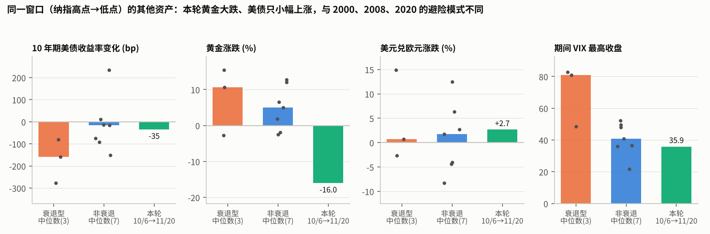
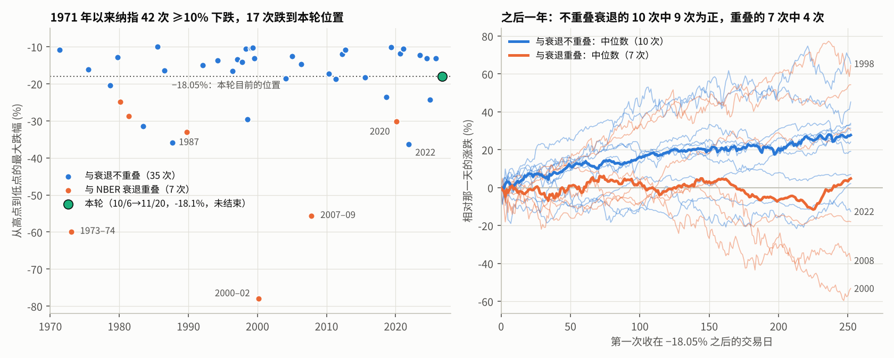

# Claude 分析 2026-11-22：是 10% 回调，还是金融危机的开端？

- **问题**（Shuai，11/22 22:01 ET）：
  - 最新这一轮下跌，是 10% 的回调，还是金融危机的开端？
  - 分析纳指以往 10% 以上的下跌；结合美股、黄金等其他资产，看资金流向和原因；
  - 审慎地回答：现在是进场的好时机吗？
- **数据截点**
  - 价格：到 11/20（周五）收盘，来自 FMP，原始返回逐字保存在 `data/fmp_raw/`。
  - 新闻与周日晚间期货：到 11/22 约 22:30 ET，见 [`data/sources_web_20261122.json`](data/sources_web_20261122.json)。
- **利益关系**：Claude 由 Anthropic 开发，本轮 ANT 也在下跌。本文不单独给 ANT 仓位建议，ANT 部分以 Codex 的 #7、#13 为参照。
- 本文是研究，**不改 `current_plan.json`**。我不是持牌投资顾问。

## 0. 结论

**1. 定性：已经不是普通的 10% 回调，但还没有金融危机的证据。**

| 截至 11/20 收盘 | 跌幅 | 归类 |
|---|---:|---|
| 纳指综合 | 自 10/6 高点 −18.05% | 离熊市（−20%）一步之遥 |
| 标普 500 | 自 10/6 高点 −11.62% | 回调 |
| 费城半导体 | 自 6 月高点约 −43%（媒体） | AI 链已是熊市 |
| NVDA | 自 10/6 约 −47.5%（媒体） | |

判断危机要看信用和资金面。这两项目前是"有压力、无危机"：

- **信用利差**：高收益债利差 11/19 为 352bp（11/13 为 323bp）。2020-03-23 的峰值是 1,087bp，2008–09 年是 2,147bp。
- **隔夜资金**：SOFR 3.91%、EFFR 3.88%，只差 3bp。11/20 纽约联储常备回购两场合计只借出 100 万美元。
- **压力集中在 AI 融资链**：
  - 数据中心贷款拍卖流拍；
  - 一只 B+ 级数据中心债跌到 89.25；
  - SpaceX 的 CDS 接近 300bp。
- 美联储 11 月金融稳定报告估计，与先进计算相关的公开债务超过 1.1 万亿美元。这是可能的传导渠道，但还没有扩散到其他行业。

**2. 历史：跌到这个位置后，一半情况还要再跌 13% 以上；一年后多数是涨的。**

- 1971 年以来，纳指有 42 次 ≥10% 的下跌（平均每年 0.75 次），其中 17 次跌到过 −18.05%。
- 这 17 次里，最终 14 次跌破 −20%，8 次跌破 −30%，3 次跌破 −50%（1973–74、2000–02、2007–09）。
- 从**第一次收在 −18.05%** 那天算起：
  - 此后再跌幅度的中位数是 13.5%（四分位 −19.0% 到 −2.1%）；
  - 到底所需时间的中位数是 28 个交易日（四分位 3 到 213）；
  - 一年后 13/17 次为正，中位数 +24.1%；最差 −53.2%（2000）。
- **决定结果的是会不会出现衰退**：

| 分组 | 次数 | 此后再跌（中位数） | 最差 | 1 年后为正 | 1 年收益中位数 |
|---|---:|---:|---:|---:|---:|
| 与 NBER 衰退不重叠 | 10 | −4.4% | −21.7%（2022） | 9/10 | +27.7% |
| 与衰退重叠 | 7 | −17.3% | −72.5%（2000–02） | 4/7 | +4.8% |

**3. 资金流向：除了美元和短期现金，几乎所有资产一起跌。**

| 10/6 → 11/20 | 变化 |
|---|---:|
| 纳指 / 标普 500 | −18.1% / −11.6% |
| 黄金 | −16.0%（自 FMP 记录的 2026 年最高收盘 3/1 起 −34.5%） |
| 比特币 | −31.2% |
| 美元兑欧元 | +2.7% |
| 10 年期 / 2 年期美债收益率 | 5.27%→4.92%（−35bp）/ 4.79%→4.63%（−16bp） |
| VIX | 15.0 → 35.9 |

- **和 2000、2008、2020 不一样**：那三次，10 年期收益率下降 80–278bp，黄金持平或上涨。本轮美债收益率只降了 35bp，绝对水平仍有 4.9%；黄金反而跌了 16%。
- **黄金为什么跌**：
  - 前半段是加息预期：10 年期一度超过 5%，美元到了 19 个月高点。
  - 11/20 当天，10 年期收益率下降 12bp，欧元兑美元持平，黄金却跌了 4.6%。这更像被动去杠杆，即为了追加保证金或筹现而卖出。Commerzbank 对路透社也是这么解释的。
- **纳指下跌期间黄金跌超 15%，1975 年以来只有 1980–84 年的三次**（−35.5%、−30.0%、−19.5%）。那是美联储对抗通胀、实际利率很高的时期。2022 年加息熊市里，黄金只跌了 1.9%。
- **钱去了哪里**：
  - 美元；
  - 货币基金：BofA/EPFR 数据显示，截至 11/4 的一周流入 1,404 亿美元；
  - 周五以后，一部分进了美债。



**4. 原因：三股力量叠加（按媒体和公开文件的归因）。**

- **利率与通胀**
  - 10 月 PPI 同比 +6.5%。
  - 市场定价 12/9 加息 25bp 的概率约 94%。
  - 伊朗局势推高油价：Brent 约 95 美元；11/18 美军轰炸格什姆岛。
  - 结果是"美联储托底"难以指望。这是与 2018、2025 两次快速见底的最大区别。
- **AI 融资与估值**：大公司用发债支撑 AI 扩张，数据中心相关的债券和贷款在重新定价。10 月起 CoreWeave、SpaceX 的信用走弱。
- **政策与公司事件**
  - 11/3 中期选举后，市场担心 AI 和数据中心监管：11/5 费城半导体单日 −12.25%。
  - BIS 远程访问新规 11/16 公布、11/19 生效。
  - 黄仁勋 11/12 辞职；SEC 调查 NVDA 的信息披露。
  - 9/12 Amodei 发文呼吁放慢前沿模型的能力提升，Altman、Musk 表示赞同。这削弱了"算力需求只会加速"的预期。

**5. 现在进场吗？可以进，但"审慎"的关键是仓位，而不是挑日子。**

- **时点**
  - 历史上在这个位置一次性买入，一年后 13/17 次为正；但一半情况会先再跌 13% 以上。
  - 分三批买入（第 0、15、30 个交易日）：一年后只有 7/17 次比一次性好，中位数少赚 2.6 个百分点。
  - 分批让前 6 个月最差浮亏的中位数从 −7.8% 降到 −5.9%。但在 2022 那种慢熊里，分批反而更差（−20.8% 对 −18.3%）。
  - 结论：分几周买，主要作用是减少后悔，不提高收益。
- **仓位**：按计划比例，SGOV 占 11%，其余 89% 是股票。
  - 纳指再跌 13.5%（历史中位数）：7,000 美元约亏 838 美元。
  - 2022 型再跌 21.7%：约亏 1,350 美元。
  - 2008 型再跌 45.8%：约亏 2,852 美元。
  - 以上按统一冲击假设计算。
- **我的建议（你来定）**
  1. 如果这笔钱三年内不用，且账面 −30% 时不会卖，本周按计划一次性建仓是合理的，不必等"最低点"。
  2. 审慎放在仓位上：
     - NVDA 我倾向用 7.5%。理由是 11/19 生效的 BIS 新规影响它的数据中心销售渠道，再加上 CEO 空缺和 SEC 调查。我 11/17 漏掉了这条新规，见 [`ERRATA_20261122.md`](../claude_analysis_20261117/ERRATA_20261122.md)（在 PR #4）。
     - ANT 不超过 3%，可以等 12/15 第一次解禁后再买。
  3. 周一不要用市价单：周日晚 Nasdaq 100 期货已涨约 2.5%，开盘可能高开。用限价单。
  4. 事先写好"不卖"的条件：只有 `current_plan.json` 的基本面规则触发才调整，价格下跌本身不卖。
  5. 以下任一出现，就暂停追加并重新评估。这些阈值是我的判断，不是历史检验过的交易信号：
     - 高收益债利差超过 500bp，或投资级超过 150bp；
     - SOFR−EFFR 超过 10bp，或常备回购使用持续放大；
     - 非科技公司发债受阻；
     - 美联储改变加息路径或启动紧急工具。



## 1. 方法（规则都写在 `drawdowns_20261122.py`）

- **一次下跌**：收盘价第一次比过去 252 个交易日的最高收盘低 10% 时开始。高点就是那个最高收盘；之后第一次创 252 日新高时结束；最低收盘为低点。
- **本轮**：10/6 收盘 27,599.79 为高点，11/20 收盘 22,617.73，跌幅 −18.05%。以这个跌幅为条件，找出历史上第一次收在同一深度的日子，往后看 21、63、126、252 个交易日。
- **衰退**：下跌区间（高点到低点）与 NBER 衰退期有重叠，即记为"与衰退重叠"。NBER 日期写在脚本里。
- **跨资产**：在每次下跌的高点日和低点日取值。
  - 标普 500：1971 年起。
  - 黄金：1975 年起。
  - 欧元兑美元：1988 年起（1999 年前为合成值）。
  - VIX：1990 年起。
  - 10 年期美债：只取了 10 次跌到本轮深度的下跌，加上本轮。FMP 一次只返回约 3 个月数据，所以按日期逐点查询。
- **分批对比**：在第一次收在 −18.05% 的日子及其后第 15、30 个交易日，各买 1/3，持有到第 252 个交易日。未投入的现金收益按 0 计算。

## 2. 跌到 −18.05% 之后（`out/after_first_close_at_current_dd.csv`）

| 高点 | 第一次收在 −18.05% | 用时（交易日） | 衰退 | 最终跌幅 | 此后再跌 | 再到底（交易日） | 3 个月 | 1 年 |
|---|---|---:|---|---:|---:|---:|---:|---:|
| 1973-01 | 1973-04-05 | 58 | 是 | −59.9% | −51.0% | 378 | −11.2% | −18.0% |
| 1978-09 | 1978-10-30 | 33 | 否 | −20.4% | −1.4% | 11 | +12.6% | +19.1% |
| 1980-02 | 1980-03-24 | 30 | 是 | −24.9% | −7.8% | 3 | +16.6% | +54.3% |
| 1981-05 | 1981-09-23 | 81 | 是 | −28.8% | −11.6% | 225 | +8.7% | +4.8% |
| 1983-06 | 1984-01-30 | 151 | 否 | −31.5% | −16.3% | 123 | −8.1% | +2.1% |
| 1987-08 | 1987-10-19 | 36 | 否 | −36.0% | −19.0% | 7 | −5.5% | +6.9% |
| 1989-10 | 1990-08-17 | 217 | 是 | −33.0% | −17.3% | 41 | −9.9% | +30.2% |
| 1998-07 | 1998-08-28 | 29 | 否 | −29.5% | −13.5% | 28 | +23.0% | +65.4% |
| 2000-03 | 2000-04-11 | 22 | 是 | −77.9% | −72.5% | 625 | +1.1% | −53.2% |
| 2004-01 | 2004-08-12 | 138 | 否 | −18.6% | 0.0% | 0 | +16.1% | +24.1% |
| 2007-10 | 2008-01-18 | 54 | 是 | −55.6% | −45.8% | 285 | +2.9% | −38.4% |
| 2011-04 | 2011-08-19 | 78 | 否 | −18.7% | −0.3% | 30 | +10.5% | +31.4% |
| 2015-07 | 2016-02-09 | 141 | 否 | −18.2% | 0.0% | 2 | +12.7% | +33.1% |
| 2018-08 | 2018-12-19 | 77 | 否 | −23.6% | −6.7% | 3 | +15.2% | +33.9% |
| 2020-02 | 2020-03-09 | 13 | 是 | −30.1% | −13.7% | 10 | +24.8% | +64.4% |
| 2021-11 | 2022-02-23 | 64 | 否 | −36.4% | −21.7% | 213 | −13.6% | −12.6% |
| 2024-12 | 2025-04-04 | 74 | 否 | −24.3% | −2.1% | 2 | +31.0% | +45.2% |
| **2026-10（本轮）** | **2026-11-20** | **33** | ? | | | | | |

- **速度**：本轮 33 个交易日跌到这里，属于快的一组。≤40 个交易日的有 6 次（1978、1980、1987、1998、2000、2020）：此后再跌的中位数为 13.6%，一年后 5/6 为正；例外是 2000。
- **与本轮最像的是加息、通胀背景下的下跌**：1981–82、1983–84、1987、2022。它们此后再跌 11.6%–21.7%，到底用了 7–225 个交易日，一年收益偏弱（+2.1% 到 +6.9%，2022 为 −12.6%）。这一归类是我的判断，样本只有 4 次。

## 3. 跨资产（`out/episodes.csv`；10 年期只覆盖下列下跌）

| 高点 → 低点 | 纳指 | 标普 500 | 10 年期（bp） | 黄金 | 欧元兑美元 | VIX 最高 | 衰退 |
|---|---:|---:|---:|---:|---:|---:|---|
| 1998-07 → 1998-10 | −29.5% | −19.0% | −92 | +1.8% | +9.1% | 49.5 | 否 |
| 2000-03 → 2002-10 | −77.9% | −44.3% | −278 | +10.6% | +2.8% | 48.5 | 是 |
| 2004-01 → 2004-08 | −18.6% | −8.0% | +11 | −2.5% | −1.7% | 21.6 | 否 |
| 2007-10 → 2009-03 | −55.6% | −56.3% | −159 | +15.4% | −13.0% | 80.9 | 是 |
| 2011-04 → 2011-10 | −18.7% | −19.4% | −152 | +6.5% | −11.1% | 48.0 | 否 |
| 2015-07 → 2016-02 | −18.2% | −14.1% | −75 | +12.7% | +4.6% | 40.7 | 否 |
| 2018-08 → 2018-12 | −23.6% | −19.3% | −15 | +5.0% | −2.6% | 36.1 | 否 |
| 2020-02 → 2020-03 | −30.1% | −33.9% | −80 | −2.7% | −0.7% | 82.7 | 是 |
| 2021-11 → 2022-12 | −36.4% | −19.5% | +234 | −1.9% | −5.9% | 36.5 | 否 |
| 2024-12 → 2025-04 | −24.3% | −18.0% | −13 | +12.0% | +4.2% | 52.3 | 否 |
| **2026-10 → 11/20（未结束）** | **−18.1%** | **−11.6%** | **−35** | **−16.0%** | **−2.6%** | **35.9** | — |

- 三次衰退型下跌：10 年期收益率中位数 −159bp，黄金中位数 +10.6%，VIX 最高中位数 80.9。
- 七次非衰退：10 年期中位数 −15bp，黄金 +5.0%，VIX 40.7。
- 本轮的 VIX 和美债，落在"非衰退"那一组的范围里。黄金则落在两组之外。

## 4. 一次性 vs 分三批（`out/lump_vs_staged.csv`）

| 17 次（第一次收在 −18.05% 后） | 一次性 | 分三批（0/15/30 个交易日） |
|---|---:|---:|
| 一年后哪种更好 | 10 次 | 7 次 |
| 一年后差额中位数（分批减一次性） | | −2.6 个百分点 |
| 前 6 个月最差浮亏，中位数 | −7.8% | −5.9% |
| 前 6 个月最差浮亏，最差一次 | −22.0%（2000） | −20.8%（2022） |

- 分批在急跌后继续急跌时有用：1987 年一年后好 10.8 个百分点，2000 年好 5.2 个百分点。
- 在 V 形反弹时吃亏：2025 年少 14.1 个百分点，2016 年少 8.8 个百分点。
- 在慢熊里没用：2022 年一年后反而差 2.7 个百分点。

## 5. 与 Codex #12、#13 的关系

- **一致**
  - #12 判断"股市广泛回调，部分压力已传到企业信用，隔夜融资数据还不足以判定系统性危机"。本文从 1971 年以来的纳指历史和跨资产角度，得到同样结论。
  - #13 建议在信用正常时一次建仓，NVDA 7.5%、ANT 3%。本文的分批回测支持"一次性"，因为时点差异平均很小。NVDA 7.5% 我也倾向。
- **补充**
  - #12 用的是标普 500 单周 ≥8% 的跌幅（1990 年起，去重后 6 次），本文用的是纳指自高点的跌幅（1971 年起，17 次），两者回答的问题不同。
  - 本文新增了黄金这条线索：黄金在去杠杆中下跌，指向"加息 + 去杠杆"的路径，而不是"避险资金涌入美债"。
- **周一的信用数据**：#13 等的 11/20 OAS 和隔夜利率，周一公布后应按 #13 的分支执行。本文第 0 节第 5 条的阈值是更远一层的"危机"线。

## 6. 局限

1. **样本小**：跌到本轮深度的只有 17 次，衰退组只有 7 次。分组结论是描述，不是概率估计。
2. **事后分组**：是否"与衰退重叠"只有事后才知道。本轮会不会出现衰退，现在无法判断。
3. **跨资产覆盖不全**：
   - 10 年期只覆盖 10 次下跌。
   - 信用利差的历史峰值只引用了 2008–09 和 2020 两个数，其他下跌没有取到。FRED 的 ICE 数据现在只提供 3 年历史，本环境也无法直接访问。
4. **比特币只保存了几行摘录**（`data/btc_extract_fmp_20261122.json`），不是完整返回。
5. **FMP 黄金序列**里的 2026 年最高收盘落在 3/1（周日），说明该序列包含周末报价。−34.5% 这个数据点应理解为"从 FMP 记录的最高值起算"。
6. **组合情景是统一冲击**：VTI、BRK-B、XLV 的实际跌幅会小于纳指，AI 个股会更大。
7. **新闻多来自检索摘要**：媒体归因不等于因果。

## 复现

```bash
python3 -I claude_analysis_20261122/drawdowns_20261122.py .
python3 -I claude_analysis_20261122/make_figures_20261122.py .
```

所有输入的 SHA-256 记录在 `out/summary.json` 的 `inputs_sha256` 和 `manifest.json`。

## 文件

| 文件 | 内容 |
|---|---|
| `drawdowns_20261122.py` | 识别下跌、条件统计、跨资产、分批对比、组合情景 |
| `make_figures_20261122.py` | 两张图 |
| `data/fmp_raw/` | FMP 原始返回：纳指、标普 500、黄金、VIX、欧元兑美元（逐字） |
| `data/treasury_rates_points_fmp_20261122.json` | 22 个日期的美债收益率（逐字） |
| `data/btc_extract_fmp_20261122.json` | 比特币摘录 |
| `data/sources_web_20261122.json` | 网页来源（转述） |
| `out/episodes.csv` | 43 次下跌（含本轮）与跨资产变化 |
| `out/after_first_close_at_current_dd.csv` | 17 次跌到本轮深度之后的走势 |
| `out/lump_vs_staged.csv` | 一次性与分批的对比 |
| `out/summary.json` | 汇总统计、组合情景、路径、输入哈希 |
| `figures/f1_nasdaq_drawdowns_since_1971.png` | 历次下跌深度，以及跌到本轮深度后的一年 |
| `figures/f2_cross_asset_signature.png` | 跨资产对照 |
