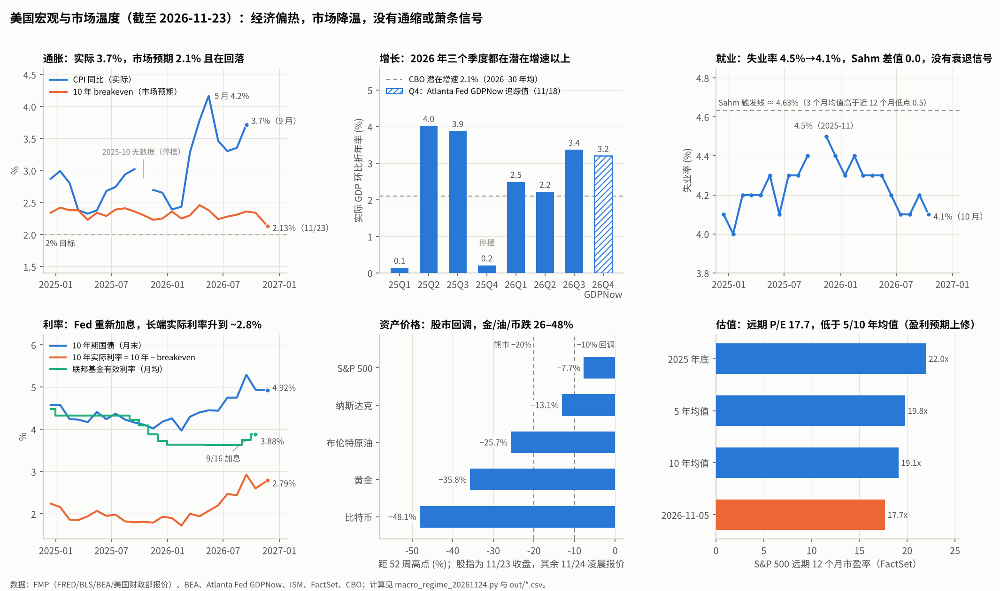

# 现在是"火热"还是"萧条"？通胀/通缩 × 增长 × 市场（数据截至 2026-11-23 收盘）

> Claude 分析，2026-11-24 凌晨（ET）。研究性质，**未修改 `current_plan.json`**。我不是持牌投资顾问；下面是数据和写成规则的判断，决定由 Shuai 做。
> 回答的问题："从通胀通缩和市场的角度告诉我，现在处于市场火热的周期还是萧条时期？"

## 0. 结论

**经济处在"后周期过热"（late-cycle overheating），不是通缩，也不是萧条。市场处在"火热之后的降温"：价格在提前交易"过热结束、增长放缓"，但没有定价萧条或通缩。**

1. **通胀，不是通缩。**
   - CPI 同比 3.7%（9 月），2026 年 5 月一度 4.2%；年初只有 2.4%。
   - 10 月 CPI 环比 +0.35%（折年约 4.3%），近 3 个月折年 5.7%，近 6 个月折年 3.1%。10 月同比没有公布，因为 2025 年 10 月停摆期间没采价。
   - PCE 同比 3.6%，核心 PCE 3.1%（9 月）；ISM 制造业价格指数 75.2。
   - 通缩信号一项都没有（§1）。
2. **增长高于潜在增速。**
   - 2026 年 Q1–Q3 实际 GDP 环比折年 2.5%、2.2%、3.4%；Atlanta Fed GDPNow 对 Q4 的追踪值 3.2%。CBO 估的 2026–2030 年潜在增速是 2.1%。
   - ISM 制造业 55.5，连续 10 个月高于 50。
   - 失业率从 4.5%（2025-11）降到 4.1%（2026-10）；Sahm 差值 0.0；近 3 个月月均新增就业 13.7 万（2025 年全年月均约 1.0 万）。
3. **Fed 在对抗过热。**
   - 9/16 加息 25bp 到 3.75–4.00%；10/28 按兵不动，但有 2 票主张加息。市场定价 12 月再加一次、2027 年继续加。
   - 10 年国债 10/5 到 5.31%，现在 4.92%。10 年实际利率（10 年 − breakeven）10/5 最高 2.95%，现在 2.79%；2025 年下半年月末值在 1.8–2.0%。
4. **市场在降温，不在定价萧条或通缩。**
   - 纳指距 52 周高点 −13.1%（11/23 收盘，当天 +6.5%），S&P 500 −7.7%，VIX 从 35.9 回到 26.6。
   - 黄金 −36%、布伦特 −26%、比特币 −48%（距 52 周高点）；美元对欧元接近一年最强。
   - 10 年 breakeven 从 10/28 的 2.38% 降到 2.13%，10 年国债从 10/5 的 5.31% 降到 4.92%。
   - 这是"增长担忧 + 去杠杆"的组合：股、金、油、币一起跌，美元涨，利率和通胀预期一起降。
   - 不是萧条定价：高收益债利差 3.23%（规则线 5%），失业率还在降。
   - 不是通缩恐慌：10 年 breakeven 在 2008-11-20 是 0.04%，2020-03-19 是 0.50%，现在 2.13%。
5. **为什么体感像萧条。**
   - 密歇根消费者信心 48.0（近 12 个月 44.8–56.6），世企联信心 81.9（9 月，8 月 88.6）。
   - 伊朗战争推高油价，汽油同比 +37.4%（10 月），物价在吃实际收入；同时股票、黄金、比特币都在跌。数据热，情绪冷。
6. **规则结果**：增长 4/4 项、通胀 4/4 项为"热"，判为过热；衰退触发 0/5；通缩触发 0/2（§1）。

**对组合的含义（不改方案）**

- 以现在的数据，本轮下跌属于 PR #14 里"不与衰退重叠"那一类（10 次：之后再跌的中位数 −4.4%，一年后 9/10 为正，中位数 +27.7%）。
- 但过热期的主要风险是 Fed 加得更多、盈利预期见顶，不是马上萧条。如果走成 2022 那样（高通胀 + 连续加息 + 无衰退），PR #14 记录的是之后又跌 21.7%、一年后 −12.6%、506 个交易日才回到前高。
- 所以"无衰退"不等于"跌完了"。PR #14 里关于仓位、限价单、暂停条件（HY > 500bp 等）的建议不变。



图：六个面板依次是通胀、增长、就业、利率、资产价格和估值。经济指标偏热，资产价格在降温，没有一项到衰退或通缩阈值。

## 1. 规则（写在 `macro_regime_20261124.py`）

**象限判定**：增长 4 项里至少 3 项为热、通胀 4 项里至少 3 项为热 → 过热；增长 ≤1 项、通胀 ≥3 项 → 滞胀；两边都 ≤1 项 → 通缩/衰退；增长 ≥3 项、通胀 ≤1 项 → 金发女孩（goldilocks）；其余 → 过渡。

| 维度 | 规则 | 当前值 | 结果 |
|---|---|---|---|
| 增长 | Q3 实际 GDP 环比折年 > 2.1（CBO 2026–30 潜在增速） | 3.37 | 热 |
| 增长 | GDPNow Q4 > 2.1 | 3.2 | 热 |
| 增长 | ISM 制造业 > 50 | 55.5 | 热 |
| 增长 | 失业率 < 4.6（CBO 2026 年均预测） | 4.1 | 热 |
| 通胀 | PCE 同比 > 2（Fed 目标） | 3.6 | 热 |
| 通胀 | 核心 PCE 同比 > 2 | 3.1 | 热 |
| 通胀 | 9 月 CPI 3 个月折年 > 12 个月同比（在加速） | 4.56 > 3.72 | 热 |
| 通胀 | ISM 价格指数 > 50 | 75.2 | 热 |

**衰退与通缩触发**（任何一项为真都要重新评估）：

| 信号 | 阈值 | 现在 | 触发？ |
|---|---|---|---|
| Sahm 差值（失业率 3 个月均值 − 前 12 个月最低的 3 个月均值） | ≥ 0.5 | 0.0 | 否 |
| 初请失业金 4 周均值 | > 25 万 | 19.8 万 | 否 |
| ISM 制造业 | < 47.5（ISM 给出的整体经济收缩线） | 55.5 | 否 |
| 高收益债利差 | > 5% | 3.23% | 否 |
| GDPNow | < 0 | 3.2% | 否 |
| 10 年 breakeven | < 1.5%（通缩恐慌） | 2.13% | 否 |
| CPI 3 个月折年 | < 0 | 5.7% | 否 |

阈值来源：2.1、4.6 来自 CBO 2026 年 2 月预测；2% 是 Fed 目标；50 和 47.5 来自 ISM 的定义；Sahm 0.5 是规则本身的定义；25 万初请和 5% 利差是经验线，不是回测过的信号。改阈值会改变"热/冷"标签，不改变数值。

## 2. 证据（`out/dashboard.csv`；逐月数值见 `out/*.csv`，汇总见 `out/summary.json`）

### 2.1 通胀：实际通胀高，市场预期在降

- **路径**（`out/inflation_monthly.csv`）：CPI 同比 2025 年在 2.3–3.0% 之间，2026 年 1–2 月 2.4%，3 月起上升，5 月 4.2%，9 月 3.7%。
- **月度波动大**：3–5 月环比 +0.87%、+0.64%、+0.47%，6 月 −0.42%，9–10 月 +0.65%、+0.35%。油价是主要来源（ABC：伊朗战争推高汽油价格）。
- **核心**：核心 PCE 同比从 3.0%（8 月）升到 3.1%（9 月）；核心 CPI 同比 2.6%（9 月）。纽约时报估算 10 月同比：整体约 4%，核心约 2.8%（非官方）。
- **市场预期**：10 年 breakeven 2.13%（11/23），一年高点 2.50%（5/4），10/28 还是 2.38%。布伦特 88.76 美元，比 50 日均价低 13.8%、比一年高点低 25.7%。
- **含义**：整体通胀很可能已经过了油价驱动的高点，但核心仍在 3% 左右，离 2% 很远。这是"通胀偏高、预期回落"，不是通缩。
- **核对**：FMP 的 `inflationRate` 就是 FRED 的 T10YIE。脚本用 20 个日值、5 个周均值、4 个月均值逐一比对 FRED 页面数值，全部吻合（gate `fred_t10yie_match`）。

### 2.2 增长与就业：高于潜在增速，劳动力市场在收紧

- **GDP**（`out/gdp_quarterly.csv`）：2025 年 Q4 只有 0.2%（停摆），2026 年 Q1–Q3 为 2.5%、2.2%、3.4%。同比 2.1%，被 2025 年 Q4 拉低；两个季度折年 2.8%。
- **BEA**：Q3 私人国内最终销售 +4.9%（折年）。
- **零售和生产**：实际零售（名义同比用 CPI 平减）9 月 +2.7%；工业生产 10 月同比 +2.1%。
- **就业**（`out/labor_monthly.csv`）：
  - 2025 年月均新增约 1.0 万，2026 年 1–10 月月均 8.6 万，近 3 个月 13.7 万。CBO 2026 年预测是月均 10.5 万。
  - 失业率 4.1%，低于 CBO 2026 年预测的 4.6%。
  - 初请 4 周均值 19.8 万。
- **Sahm 差值**：2026 年 2 月是 0.27，之后一路降到 0.0。

### 2.3 政策与利率：紧在长端

- **联邦基金有效利率**（月均）：2024-12 4.48% → 2026-01 至 08 约 3.63–3.64%（2025 年 9–12 月三次降息）→ 9 月加息后 10 月 3.88%。
- **实际政策利率**（有效利率 − 核心 PCE）约 +0.8%，只是温和偏紧。
- **长端**（`out/rates_monthly.csv`、`out/rates_daily_recent.csv`）：
  - 10 年国债月末值 2025 年在 4.0–4.6%，2026-09 末 5.29%；8/25 以来日数据的最高点是 10/5 的 5.31%。
  - 10 年实际利率从 2025 年下半年的 1.8–2.0% 升到 9 月末 2.93%，10/5 最高 2.95%。
  - 30 年房贷 7.28%（11/19），7/2 是 6.43%。
- **曲线**：10 年 − 3 个月 +55bp，10 年 − 2 年 +29bp，没有倒挂。3 个月国库券 4.37%，高于有效利率 3.88%，和"再加息"的定价一致。

### 2.4 市场：从火热降温

- **股票**：纳指距 52 周高点 −13.1%；52 周高点是盘中值，按 PR #14 的收盘高点算约 −12.7%。S&P 500 −7.7%。
- **跨资产**：黄金 −35.8%、布伦特 −25.7%、比特币 −48.1%（距 52 周高点）；EUR/USD 1.0906，离 52 周低点 1.0884 只差 0.2%（美元强）。
- **估值**：FactSet 统计 S&P 500 远期 P/E 17.7（11/5），低于 5 年均值 19.8 和 10 年均值 19.1。2025 年底是 22.0。下降主要因为远期 EPS 预期年初以来上修 33.6%，同期指数只涨 7.4%（截至 11/5）。
- **信用**：高收益债利差 3.23%；CCC 级约 10%，比今年低点扩大 500bp 以上，BB/B 级仍平稳。

### 2.5 裂缝：可能先坏的地方

- **住房**：10 月开工 130.9 万套（年化），比 3 月的 152.2 万低 14%。
- **信用底层**：CCC 利差；Vanguard 也提到私人信贷违约在上升。
- **情绪**：消费者信心 48.0；世企联 81.9。
- **政治冲击**：11/3 中期选举民主党拿下参众两院，11/5 纳指单日 −5.52%。

## 3. 什么会改变结论

- **转向衰退/通缩**：§1 的 7 个触发里任何一项为真。
- **过热加剧、滑向滞胀**：我会盯下面 4 项。这些是我的判断阈值，不是回测过的信号。
  - 核心 PCE 3 个月折年持续高于 3.5%；
  - 10 年国债突破 10/5 的 5.31%；
  - 布伦特重回 110 美元以上；
  - 12/8–9 FOMC 点阵图把 2027 年加息路径上调。
- **日程**：11/25 BEA 发布 Q3 GDP 第二次估计；12/8–9 FOMC；12/10 公布 11 月 CPI。

## 4. 与之前分析的关系

- **PR #14**（`claude/nasdaq-drawdowns-20261122`）：给出本轮下跌的历史对照，按是否与 NBER 衰退重叠分组。本目录回答"现在的宏观数据属于哪一组"：目前是不衰退的那组。
- **2022 那一行**：来自 PR #14 的 `out/after_first_close_at_current_dd.csv`（peak 2021-11-19）：再跌 −21.7%，一年 −12.6%，回到前高用了 506 个交易日。
- **Codex #12**：用 FRED 信用利差判断压力。本目录的 HY 3.23% 来自 Trefis（11/17），口径可能和 FRED ICE BofA OAS 有小差别。

## 5. 局限

1. **停摆缺数**：2025 年 10 月没有 CPI 和失业率。2026 年 10 月 CPI 同比无法计算。含 2025-10 的 3 个月失业率均值只用了 2 个月。
2. **网页数据**：PCE、ISM、GDPNow、FactSet P/E、HY/CCC 利差、FOMC 决议来自网页报道（`data/sources_web_20261124.json`），没有用原始数据重算。CPI、GDP、就业、利率、breakeven 和价格来自 FMP 原始响应。BLS/BEA 公布值和脚本计算值的对照写在 gate 里，全部通过。
3. **"热/冷"标签依赖阈值**（§1）。规则判断的是当前状态，不是预测；市场通常领先数据，现在价格已经在交易放缓。
4. **数据节选**：国债和 2024-12 至 2025-10 的 breakeven 只存了月末行，日数据只覆盖 2025-11-24（breakeven）和 2026-08-25（国债）之后。所以"10/5 是高点"只在这段日数据内成立；更早的月末值都低于它。
5. **报价时间不同**：股指是 11/23 收盘价；黄金、布伦特、比特币、EUR/USD 是 11/24 01:48 ET 前后的隔夜报价。52 周高低点是 FMP 报价里的盘中值。

## 复现

```bash
python3 -I claude_analysis_20261124/macro_regime_20261124.py .
python3 -I claude_analysis_20261124/make_figures_20261124.py .
```

脚本只读 `data/`，有任何 gate 不通过就退出。输入的 SHA-256 记录在 `out/summary.json` 的 `inputs_sha256` 和 `manifest.json`。

## 文件

| 文件 | 内容 |
|---|---|
| `data/fmp_economics_indicators_20261124.json` | FMP 宏观指标原始响应：CPI、失业率、非农、GDP、联邦基金、初请、信心、衰退概率、工业生产、零售、房贷利率、新屋开工 |
| `data/fmp_t10yie_inflationRate_20261124.json` | 10 年 breakeven 日数据（2025-11-24 至 2026-11-23 全量、2008 和 2020 两段）及月末节选 |
| `data/fmp_treasury_rates_20261124.json` | 国债收益率曲线：2026-08-25 至 11-23 全量响应，2024-12 至 2026-07 月末行 |
| `data/fmp_quotes_20261124.json` | 指数、黄金、布伦特、EUR/USD、比特币报价原始响应 |
| `data/sources_web_20261124.json` | 网页来源的数值、日期和链接 |
| `macro_regime_20261124.py` | 计算、规则和 gate |
| `make_figures_20261124.py` | 作图（只读 `out/`） |
| `out/dashboard.csv` | 证据表 |
| `out/inflation_monthly.csv`、`gdp_quarterly.csv`、`labor_monthly.csv`、`rates_monthly.csv`、`rates_daily_recent.csv`、`markets.csv` | 中间数据 |
| `out/summary.json` | 关键数值、规则结果、gate、输入哈希 |
| `figures/f1_macro_market_dashboard.png` | 六面板图 |
| `manifest.json` | 文件哈希与干净导出复跑记录 |
